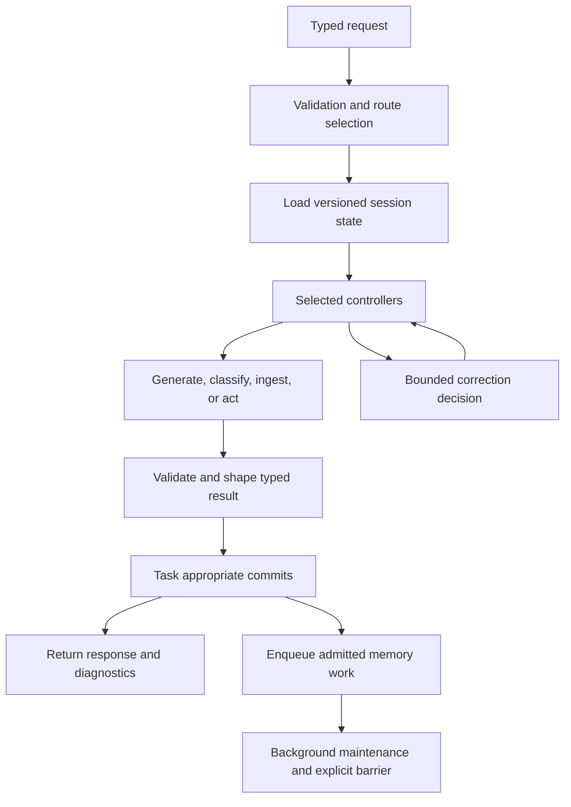
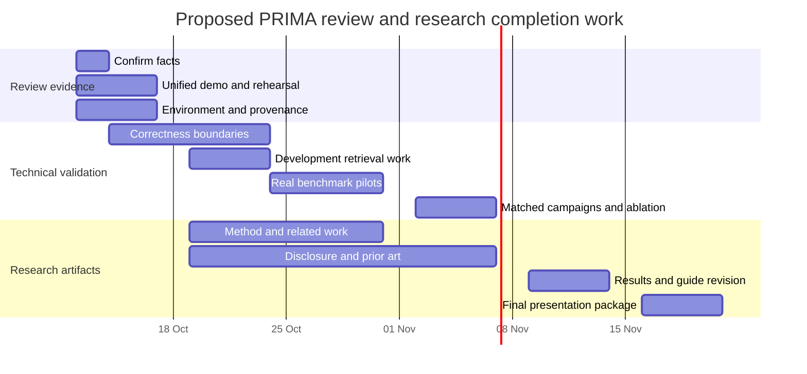

# PRIMA-NEXT: Phase 3, Progress Review 2 preparation

Prepared: **10 October 2026 (Asia/Calcutta)**. Inspected source commit: `4cd51950b22abbab22a0553348df51a36ac20c30`.

Template: [Phase-3 Review 2.pptx](<C:/Users/Yuv Nahar/Downloads/Phase-3 Review 2.pptx>). This document answers every substantive prompt in its 12 slides. It is a detailed content and speaker-notes source for filling the presentation, with additional technical, demo, and paper/patent material requested by the team.

The template's statements, including “50% of Demonstration should have been completed,” are review requirements, not evidence that PRIMA has met them. No percentage of completion is invented here. The PPTX has not been edited. A unified executable demonstration has not been built by this documentation task; Section 7 provides its sample, sequence, assertions, narration, and comparison specification.

## 0. Evidence rules and current review position

Use these labels consistently when speaking:

| Label | What it establishes |
|---|---|
| **Source verified** | Implementation or a test assertion was inspected in this checkout. This alone does not mean that test passed today. |
| **Fresh test** | A named command actually completed during preparation on 10 October 2026. |
| **Saved artifact** | An existing result file was inspected. Its experiment was not independently rerun. |
| **Reported pilot** | A repository note reports an external hardware run, but its original archive was not revalidated during this task. |
| **Proposed / pending** | Work, schedule, or evaluation design still to execute. |
| **Team confirmation required** | Administrative or publication facts not established by the available evidence. |

**Defensible opening statement:**

> PRIMA-NEXT is an experimental Python agent runtime that combines memory, hybrid retrieval, emotion-related signals, planning, symbolic simulation, uncertainty decisions, bounded reflection, and controlled tools through one typed execution interface. The code and tests establish integration mechanisms. Saved subset experiments identify useful retrieval choices. Full matched benchmark evidence and verified publication or patent milestones remain to be completed or supplied.

### 0.1 Main evidence register

The references below are local proof links. Later sections cite their IDs alongside more specific source and test files.

| ID | Evidence | How to use it |
|---|---|---|
| E01 | [README](C:/PRIMA_next/README.md) | Project purpose, setup, quick start, research scope, license. |
| E02 | [Public contracts](C:/PRIMA_next/runtime/contracts.py), [route plans](C:/PRIMA_next/runtime/route_profiles.py) | Current task/profile combinations, inputs, outputs, diagnostics, budgets. |
| E03 | [Runtime](C:/PRIMA_next/runtime/prima_runtime.py), [workflow](C:/PRIMA_next/workflow/prima_workflow.py), [orchestration](C:/PRIMA_next/workflow/orchestration_engine.py) | Construction, execution order, controller ownership, error handling. |
| E04 | [Project explanation](C:/PRIMA_next/docs/PROJECT_EXPLAINED.md), [file reference](C:/PRIMA_next/docs/PROJECT_FILE_REFERENCE.md) | Broad technical map and dated audit findings. These are explanatory secondary sources. |
| E05 | [Result claim policy](C:/PRIMA_next/docs/benchmarks/RESULT_CLAIM_POLICY.md) | Conditions for fair comparisons and reportable results. |
| E06 | [12-hour Kaggle plan](C:/PRIMA_next/docs/kaggle-12-hour-plan.md) | Reported October 6 LoCoMo pilot and earlier operational problems. |
| E07 | [Saved embedding JSON](C:/PRIMA_next/evaluation/results/final/embedding_ablation_results.json), [CSV](C:/PRIMA_next/evaluation/results/final/embedding_ablation.csv) | 197-query, one-conversation retrieval subset comparisons. |
| E08 | [Saved representation JSON](C:/PRIMA_next/evaluation/results/final/representation_ablation_results.json), [CSV](C:/PRIMA_next/evaluation/results/final/representation_ablation.csv) | Raw versus semantic/event representations using Nomic. |
| E09 | [Release readiness](C:/PRIMA_next/docs/implementation/RELEASE_READINESS.md) | Historical fake-provider and fault-injection evidence, with its stated scope and limits. |
| E10 | [CI workflow](C:/PRIMA_next/.github/workflows/ci.yml), [quality configuration](C:/PRIMA_next/pyproject.toml) | Checks configured for Python 3.14. Configuration is not a fresh CI pass. |
| E11 | [Contributors](C:/PRIMA_next/CONTRIBUTORS.md) | Git-derived contributor names. This does not establish official academic team details. |
| E12 | [Benchmark runbook](C:/PRIMA_next/docs/benchmarks/RUNBOOK.md), [Kaggle smoke validation](C:/PRIMA_next/docs/kaggle-smoke-validation.md) | Execution, pilot, resource, scoring, resume, and packaging procedures. |

**Documentation conflicts to explain:** the historical architecture matrix mentions 25 pairs and nine valid routes. Current E02 defines **six tasks, five profiles, 30 possible pairs, ten valid pairs**. E07/E08 describe saved Python 3.10 subset runs, whereas current README/CI target Python 3.14. Older top-level ablation summaries mark learned models unavailable, while the separate `final/` subset artifacts record completed learned-backend runs. Keep these experiment scopes separate. JSON and CSV backend fingerprints also differ in E07/E08, despite agreement on displayed metrics. These files therefore need provenance reconciliation before paper-grade reuse.

## 1. Slide 1: project identity and motivation

### 1.1 Administrative fields

| Template field | Value to put on the slide |
|---|---|
| Course/review | UE23CS441A, Capstone Project Phase 3, Project Progress Review #2. |
| Project title | **PRIMA-NEXT** is the repository name. Confirm the official expanded academic title. |
| Project ID | **[TEAM TO CONFIRM]** |
| Project guide | **[TEAM TO CONFIRM]** |
| Project team | Git contributors: Yuv Nahar, K Rajeev, K Abhiram, ZeroDeaths7. Confirm legal/full names, student IDs, and academic membership before using these as the official roster. [E11] |
| Review date | **[TEAM TO CONFIRM]**. This document's preparation date is not the review date. |

### 1.2 Problem statement

A language model's response depends on its supplied context and learned parameters. A continuing agent must also decide what historical information to retain, which evidence to retrieve now, how much work to spend on missing evidence, whether to abstain, and what operations it may perform. PRIMA's engineering problem is to give these decisions explicit owners and observable outcomes.

The research question is whether the additional memory and cognitive mechanisms improve useful behavior enough to justify their latency, model calls, and storage cost relative to the **same model alone** and **simple RAG**. A large number of modules is an implementation fact, not an answer to that research question. [E01–E05]

### 1.3 Objectives and acceptance evidence

| Objective | Evidence that would establish it |
|---|---|
| Retain and recover relevant historical facts | Admitted source records, provenance, held-out retrieval recall, memory-assisted QA outcomes. |
| Use task-appropriate processing | Route tests and diagnostics showing required execution and short-route exclusions. |
| Bound uncertainty and correction work | Recorded decisions, correction budgets, stopping reasons, helped/harmed outcome counts. |
| Execute controlled tools | Validated arguments, policy decisions, handler results, blocked-action evidence. |
| Evaluate reproducibly | Frozen IDs/settings, native scoring, failure accounting, complete validated artifacts. |
| Communicate publication progress honestly | Manuscript version, submission receipt, acceptance notice or patent filing receipt, as applicable. |

**Speaker explanation:** “We implement the agent's surrounding control system. We use existing language models and configurable embedding/classification models. We do not claim to have trained a new foundation model.”

## 2. Slide 2: outline

Use this review order:

1. Previous review suggestion and our response.
2. Problem, current methodology, and measured results.
3. Runtime workflow, algorithms, and design alternatives.
4. One coherent demo scenario and baseline comparison.
5. Completed modules, test evidence, and remaining limits.
6. Applicability to other domains.
7. Paper/patent status and supporting artifacts.
8. Pending-task timeline, conclusion, and references.

The publication/patent section is an addition requested by the team. The template does not contain a dedicated slide for it. Place it before the timeline or use an additional slide under the methodology expansion allowance.

## 3. Slide 3: suggestions from Review 1

### 3.1 Verified suggestion and feasibility

The user reports that the previous panel requested **a demo script showing every module working for one sample, with a comparison**. No other panel remarks were supplied. Do not invent them.

| Suggestion | Feasibility | Current progress | Remaining evidence |
|---|---|---|---|
| Demonstrate modules on one sample | Feasible as one scenario using several typed requests. QA, ingestion, affect classification, and tools intentionally use different routes. | Canonical routes, detailed diagnostics, integration tests, and controlled tools exist. [E02/E03] | A rehearsed executable scenario with exported traces, actual outputs, and maintenance completion. |
| Include a comparison | Feasible using existing `model_only`, `simple_rag`, and `prima_full` profiles. | Profiles and paired benchmark infrastructure exist. [E02/E05] | Matched real-provider outputs, identical source opportunity/settings, native scoring, cost measurements. |
| Show testing of completed modules | Feasible through existing tests and fault injection. | Fresh 25-test subset passes. Broader async run did not complete. See Section 8. | Fresh wider-suite evidence in a functioning environment. |

### 3.2 What to say about the demo's progress

> We have the runtime routes and test scaffolding needed for the panel's suggestion. We now have a single-scenario demonstration specification. The unified runnable demo, saved real-provider comparison, and rehearsal are pending. We will demonstrate each module through its appropriate route and show when a component was actually executed.

`main.py` is an affect demo. It does **not** establish that the full PRIMA workflow works. [E01/E04]

“Every module” should mean every claimed runtime responsibility, not every source file, training utility, benchmark adapter, or legacy helper. Reflection is conditional, and background maintenance needs an explicit completion barrier. One successful answer cannot honestly prove all of those paths ran.

## 4. Slide 4: proposed approach / methodology

### 4.1 Basic approach

The public entry is `PrimaRuntime.execute(PrimaRequest(...))`. A request declares its task and profile. Immutable, extra-forbidding Pydantic contracts validate the input. Reserved metadata keys cannot override execution controls. The runtime selects a valid route, constructs an execution context, delegates to the workflow, and returns a typed response with evidence, errors, state changes, and diagnostics. [E02/E03]



This is an explanatory flow, not a claim that every box executes on every request. Use the actual route and trace as evidence.

### 4.2 Task/profile routes

| Task | Supported profiles | Behavior and excluded work |
|---|---|---|
| Conversation | `model_only`, `simple_rag`, `prima_full` | Generate a reply. Memory admission and state handling depend on the route/policy. |
| Factual QA | `model_only`, `simple_rag`, `prima_full` | Generate structured factual output or abstain. Factual routes omit conversation `memory_commit`. |
| Historical replay | `prima_full` | Process past turns through affect/state/admission without generating new assistant replies. |
| Document ingestion | `ingestion_only` | Encode/store the document through the workflow, without answer generation. |
| Emotion classification | `affect_only` | Classify/update affect, excluding QA retrieval, planning, world simulation, and tools. |
| Tool request | `prima_full` | Plan/gate an action, excluding answer generation. |

Ten supported pairs out of thirty possible combinations. Unsupported pairs are rejected. `model_only` skips retrieval. `simple_rag` selects dense/sparse retrieval. Capable `prima_full` routes add temporal/graph retrieval and cognitive decisions. [E02]

### 4.3 Complete technical stage explanation

| Stage | Input and operation | Output / purpose | Implementation proof and limit |
|---|---|---|---|
| Input boundary | Text, task/profile, session, generation settings, options. Validate nonblank content and reject undeclared/reserved fields. | Trusted execution controls and rejected invalid requests. | [Contracts](C:/PRIMA_next/runtime/contracts.py), [principal hardening tests](C:/PRIMA_next/tests/runtime/test_principal_hardening.py). “Principal” in this test name does not prove complete multiuser isolation. |
| State load | Session identity and versioned state manager. | A consistent cognitive/emotional state snapshot. | [State manager](C:/PRIMA_next/state/state_manager.py), [ownership tests](C:/PRIMA_next/tests/state/test_state_ownership.py). JSON locks are process-local. |
| Affect | Classify text, derive emotion profile/PAD, update temporal history and momentum. | Affect/state signals for downstream salience, retrieval priors, and reflection triggers. | [Affect engine](C:/PRIMA_next/affect/affect_engine.py), [classifier factory](C:/PRIMA_next/affect/classifier_factory.py). Legacy default and learned backends must be identified. No clinical interpretation is established. |
| Memory representation | Store a typed `MemoryNote` with text, embedding, metadata, time/provenance. | Recoverable source evidence and derived graph references. | [Memory note](C:/PRIMA_next/memory/memory_note.py), [index](C:/PRIMA_next/memory/memory_index.py), [repository selection](C:/PRIMA_next/memory/repository_factory.py). In-memory test storage differs from persistent production storage. |
| Query analysis/rewrite | Extract lexical/entity/time cues and deterministic expansions. | Traceable retrieval query. | [Query analysis](C:/PRIMA_next/memory/retrieval/query_analysis.py). This is engineered rewriting, not a learned universal intent parser. |
| Candidate retrieval | Dense vectors, sparse lexical matches, temporal conditions, graph traversal where selected. | Candidate memory IDs, scores, and strategy contributions. | [Retrieval controller](C:/PRIMA_next/memory/retrieval/retrieval_controller.py), [router](C:/PRIMA_next/memory/retrieval/retrieval_router.py). A hash embedding is a deterministic baseline, not a learned semantic model. |
| Fusion and reranking | Normalize/merge candidates by memory ID, weight available strategies, rerank. | Ordered evidence candidates and backend identity. | [Fusion](C:/PRIMA_next/memory/retrieval/hybrid_fusion.py), [reranker](C:/PRIMA_next/memory/retrieval/reranker.py). Lexical and cross-encoder backends have different costs/capabilities. |
| Evidence reasoning | Integrate evidence, check sufficiency, request follow-up information within budgets. | Selected evidence, stop reason, or abstention. | [Reasoning controller](C:/PRIMA_next/reasoning/controller.py), [sufficiency verifier](C:/PRIMA_next/reasoning/sufficiency_verifier.py). Current word coverage does not establish semantic entailment. |
| Context compression | Fit selected evidence to the request budget and preserve source mappings. | A bounded model context with recorded drops/loss. | [Compressor](C:/PRIMA_next/memory/retrieval/context_compressor.py). Approximate tokens can differ from provider tokenizer counts. |
| Planning | Select goals/actions/constraints and evaluate a plan. | Explicit intended execution and risk/replan signals. | [Task planner](C:/PRIMA_next/planning/task_planner.py), [plan evaluator](C:/PRIMA_next/planning/plan_evaluator.py). Deterministic planning is not a general learned planner. |
| World simulation | Apply symbolic rules and predict action/state transitions. | Constraint/risk predictions supplied to decisions. | [Predictive model](C:/PRIMA_next/world/predictive_model.py), [simulator](C:/PRIMA_next/world/state_simulator.py). No learned physical world model is claimed. |
| Uncertainty | Aggregate retrieval/planning/affect/state/policy/reflection signals and disagreement. | Confidence, uncertainty, decision recommendations. | [Estimator](C:/PRIMA_next/uncertainty/uncertainty_estimator.py), [aggregator](C:/PRIMA_next/uncertainty/confidence_aggregator.py). These scores require empirical calibration before probabilistic accuracy claims. |
| Reflection/correction | Produce typed advice. Workflow validates it, checks budgets, applies bounded retrieval/replan/retry/regeneration. | Recorded proposal, acceptance, before/after snapshots. | [Reflection adapter](C:/PRIMA_next/reflection/reasoning_reflection_adapter.py), [correction loop](C:/PRIMA_next/workflow/correction_loop.py). Evaluator-only truth-aware helpers must stay outside inference. |
| Action/tools | Check policy/allowlist/schema, route registered handler, record result/audit. | Successful, blocked, invalid, missing, timed-out, or failed action. | [Execution policy](C:/PRIMA_next/action/execution_policy.py), [executor](C:/PRIMA_next/tools/tool_executor.py). Application tags do not create OS isolation. |
| Model generation | Build trusted policy plus untrusted evidence context. Call configured provider and parse structured output/citations. | Generated answer tied to evidence labels. | [Answer generation](C:/PRIMA_next/workflow/answer_generation.py), [prompt builder](C:/PRIMA_next/llm/prompt_builder.py), [response parser](C:/PRIMA_next/llm/response_parser.py). Valid citations alone do not prove claim support. |
| Output validation/shaping | Check typed result, structure, selected citations, and errors. | Explicit answered/abstained/failed/ingested/classified/actioned result. | [Output validation](C:/PRIMA_next/workflow/output_validation.py), workflow output controller [E03]. No input echo fallback should substitute for failed generation. |
| Commit/admission | Commit versioned state and apply task-appropriate memory policy. | State delta and admitted/rejected memory with reason. | [Memory importance](C:/PRIMA_next/memory/maintenance/memory_importance.py), [admission tests](C:/PRIMA_next/tests/memory/test_memory_admission.py). State/content/index/queue operations are separate, not a demonstrated all-or-nothing transaction. |
| Maintenance | Bounded background work: scoring, consolidation, abstraction/evolution, graph refresh, decay/soft forgetting. | Completion/failure accounting and updated derived memory. | [Maintenance tests](C:/PRIMA_next/tests/memory/test_phase08_background_maintenance.py), [event tests](C:/PRIMA_next/tests/test_events_phase6.py). Process-local queues need durability work for crash recovery. |
| Research evaluation | Evaluator scores predictions after inference using protected gold data. | Native metrics, failures, paired differences, reproducible artifacts. | [Campaign comparison](C:/PRIMA_next/benchmarks/campaign/comparison.py), [aggregation](C:/PRIMA_next/benchmarks/campaign/aggregation.py), E05. Gold answers must not enter prompts or retrieval decisions. |

### 4.4 Memory taxonomy

The five logical types are **working, episodic, semantic, emotional, procedural**. Working memory supports immediate context. Episodic memory records experiences/turns. Semantic memory stores generalized information. Emotional memory represents affect-related records. Procedural memory stores verified successful tool procedures or explicit imports. These types share repository/index machinery rather than requiring five separately deployed databases. Graph nodes/edges reference memory IDs and retain derived metadata. [E04, [memory types](C:/PRIMA_next/memory/memory_types.py)]

### 4.5 Results obtained: saved retrieval experiments

**Scope:** E07/E08 record one LoCoMo conversation, 197 queries, seed 13, candidate `top_k=30`, identity normalization enabled, `subset_validation=true`, Python 3.10.11, and a GTX 1650 environment. The table reports metric Recall@5, which differs from the candidate-generation top-k setting. These are saved component results, not current full-dataset QA results.

| Embedding backend, semantic representation | Recall@5 | MRR | nDCG@5 | Candidate success | Total recorded execution, s |
|---|---:|---:|---:|---:|---:|
| Stable hash | 1.0152% | 0.010081 | 0.007262 | 7.1066% | 5.740125 |
| MiniLM | 15.7783% | 0.110655 | 0.101168 | 44.6701% | 22.439328 |
| BGE small | 15.7360% | 0.138600 | 0.122296 | 41.6244% | 15.200265 |
| Nomic | 32.9103% | 0.254356 | 0.246090 | 69.5431% | 30.752234 |

Nomic exceeds the hash backend by **31.8951 percentage points of Recall@5** in this saved subset. Execution time also increases. Do not call this a full PRIMA accuracy improvement or deployment latency measurement. [E07]

| Nomic representation | Recall@5 | MRR | Candidate success | Total recorded execution, s |
|---|---:|---:|---:|---:|
| Raw | 40.3130% | 0.323311 | 71.5736% | 26.766301 |
| Semantic | 32.9103% | 0.254356 | 69.5431% | 46.441355 |
| Event | 35.5753% | 0.268545 | 65.4822% | 31.707180 |

Raw exceeds semantic by **7.4027 percentage points** and event by **4.7377 points** on Recall@5. This supports investigating the simplest representation first, rather than assuming more structure always helps. Timings come from different recorded runs, so do not combine them into a common wall-time breakdown. Fingerprint/provenance discrepancies need resolution before publication. [E08]

### 4.6 Results obtained: reported operational pilot

E06 reports that session `20261006T044633Z-3d208184`, commit `8f54b16`, used the repository-recorded pinned Qwen3.8 27B identity, 8192 context, and two T4 GPUs. Sequential/concurrent representative pilots each completed the same 30 questions with zero execution failures and complete maintenance. All 30 predictions/evidence/evaluation decisions passed the equality check. Two active requests were observed.

The reported admitted estimate was **9.2202 campaign hours** and **10.1859 total session hours**, with a 20% margin and artifact reserve. These are projections that admitted a full run, not observations of full completion.

On a separate shared 15-case comparison, reported F1 was **14.10% versus 15.18% previously**, a decrease of **1.08 percentage points**. Final evidence recall remained **23.17%**. This comparison concerns pilot versions, not model-only versus PRIMA. No quality gain is established. HotpotQA and GoEmotions remained unmeasured on this hardware in that note. The original archive was not revalidated here. [E06]

### 4.7 Is there a need to change the approach?

**Retain the canonical runtime and controlled evaluation approach. Refine retrieval choices and execution reliability using measured evidence.** Current evidence does not justify adding more cognitive modules merely to enlarge the architecture.

Candidate refinements are a learned embedding backend with raw text, stage-by-stage retrieval diagnosis, semantic sufficiency evaluation, and focused ablations of optional components. Benefits could include better evidence coverage, clearer contribution attribution, and lower unnecessary overhead. Drawbacks include model loading cost, extra GPU/RAM use, new calibration work, and migration/reindexing when representations change.

The October operational repair addressed dropped maintenance work using bounded producer backpressure and owning-runtime embedding context. Concurrency is admissible only when each benchmark's fresh pilot establishes equality, real overlap, resource safety, and time feasibility. Previous failed or passing timings cannot substitute for a new measured gate. [E06]

## 5. Slide 5: algorithms and pseudocode

### 5.1 Canonical workflow pseudocode

This is explanatory pseudocode aligned with E02/E03, not a replacement executable API or a guarantee that all phases run.

```text
EXECUTE(request):
    validate typed request and reserved metadata
    select supported task/profile route; reject invalid pairs
    build trusted execution context and effective budgets
    load versioned session state
    for each phase selected by the route:
        run its controller; record start/result/error
        if a decision requires correction:
            validate typed advice and remaining budget
            apply only the permitted bounded correction
            record actual before/after state and stop reason
        if cancellation/failure occurs:
            return explicit typed outcome with diagnostics
    shape existing generation/classification/ingestion/action result
    commit only the effects permitted by that task and policy
    enqueue admitted maintenance with bounded backpressure
    return typed response, evidence, state delta, and diagnostics
```

### 5.2 Hybrid retrieval algorithm

Dense, sparse, temporal, and graph strategies return scored candidates. Fusion uses each memory ID once and retains the maximum score for that ID within a strategy. For a nonconstant strategy score range, it applies min-max normalization. Equal-score lists retain their original scores. Missing contributions count as zero. Active strategy weights renormalize using their total weight. [E02, [fusion source](C:/PRIMA_next/memory/retrieval/hybrid_fusion.py)]

```text
FUSED_SCORE(memory) =
    sum(weight[strategy] * normalized_score[strategy, memory])
    / sum(weight[strategy] for selected strategies)

Default full-profile weights:
    dense 0.40, sparse 0.30, temporal 0.15, graph 0.15

RETRIEVE(query):
    analyze and rewrite query
    run strategies supported by route/capabilities
    merge and weight candidates by memory ID
    select top candidates and apply configured reranker
    integrate evidence and preserve source mapping
    check sufficiency; follow up only within budgets
    compress context and record dropped evidence
```

The algorithm is weighted score fusion, not automatically reciprocal rank fusion. Default values in [retrieval YAML](C:/PRIMA_next/config/retrieval.yaml) must be distinguished from request/campaign overrides.

### 5.3 Memory importance and admission

The default normalized importance function is:

```text
I = 0.35 * novelty
  + 0.25 * emotional_salience
  + 0.15 * user_relevance
  + 0.15 * recurrence
  + 0.10 * reflection

admit when I >= 0.55
```

Novelty queries episodic candidates, then uses `1 - maximum token Jaccard overlap`. User relevance uses explicit lexical/personal-interest cues. The scoring components are bounded to [0,1]. This is an interpretable heuristic, not a learned proof of long-term usefulness. Admission is distinct from explicit document ingestion, state persistence, and maintenance completion. [Memory importance](C:/PRIMA_next/memory/maintenance/memory_importance.py), [types/defaults](C:/PRIMA_next/memory/maintenance/importance_types.py), [configuration](C:/PRIMA_next/config/memory_importance.yaml).

### 5.4 Affect evolution

`update_momentum` decays prior scores with default factor **0.82**, drops very small values, and adds current dominant-emotion confidence. PAD represents pleasure, arousal, and dominance. Volatility averages recent PAD distances, bounded to 1. Stability combines low volatility and current confidence. Dissonance examines recent history, valence flips, and low confidence. [Evolution source](C:/PRIMA_next/affect/affect_evolution.py), [PAD](C:/PRIMA_next/affect/pad_model.py).

Explain this as engineered temporal text-affect tracking. It does not measure a person's true internal emotional state.

### 5.5 Sufficiency, confidence, and stopping

The current sufficiency verifier intersects question/evidence terms and accepts coverage of at least **0.60**, unless its narrow contradiction check fires. No evidence produces an unanswerable decision. More evidence can be requested under a bounded budget. This can fail on paraphrases or lexical distractors, so the score should not be described as semantic proof. [Verifier](C:/PRIMA_next/reasoning/sufficiency_verifier.py).

The confidence aggregator calibrates available signals, forms weighted means, adds disagreement to uncertainty, and reduces confidence with disagreement. Default source weights include retrieval 1.25, planning 1.15, affect 0.70, state 0.85, reflection/policy 1.0. These are source-specific weights inside a broader effective-weight mechanism, not standalone accuracies. [Aggregator](C:/PRIMA_next/uncertainty/confidence_aggregator.py).

Public request defaults are top-k **5**, maximum hops **3**, retrieval calls **3**, and context tokens **1600**. Reasoning additionally has configured document/model/time/no-progress limits. Campaigns may override defaults. Read recorded effective budgets when explaining a result. [E02, [reasoning configuration](C:/PRIMA_next/reasoning/config.py)]

### 5.6 Controlled tools and corrections

```text
TOOL(invocation, policy):
    reject external actions unless explicitly enabled
    check name, allowlist/blocklist, invocation limit and tags
    resolve registered tool
    validate arguments against tool schema
    execute handler; bound awaitable work with configured timeout
    require typed tool result; return audit and explicit errors

CORRECT(advice):
    check supported proposal and confidence/trigger conditions
    reject advice when its budget is exhausted
    route to permitted retrieval/replanning/retry/regeneration
    preserve before/after snapshots and outcome
```

Tool defaults allow no external tools, limit invocations to **3**, and set awaitable timeout to **5 seconds**. A synchronous handler can block before that awaitable timeout applies. Reflection generates advice; workflow owns its application. Gold-aware legacy evaluators cannot supply production advice. [Execution policy](C:/PRIMA_next/action/execution_policy.py), [tool executor](C:/PRIMA_next/tools/tool_executor.py), [correction loop](C:/PRIMA_next/workflow/correction_loop.py).

## 6. Slide 6: design approach, benefits, drawbacks, alternatives

### 6.1 Chosen design

The project follows a **modular, typed, workflow-controlled design**. Subsystems handle specific responsibilities, while the workflow owns operation order and corrections. Runtime routes select the required components. Content storage is authoritative, graph data is derived, provider access is isolated behind an LLM boundary, and benchmark scoring remains outside production inference. [E02/E03, [architecture decision](C:/PRIMA_next/docs/architecture/ADR_CANONICAL_RUNTIME.md)]

| Decision | Why it helps | Drawback / tradeoff |
|---|---|---|
| One typed execution interface | Applications/tests/benchmarks share validation and output semantics. | Runtime assembly and compatibility code are substantial. |
| Explicit task/profile routes | Cheap tasks skip irrelevant work and comparisons select clear configurations. | Route/diagnostic consistency needs tests when tasks evolve. |
| Workflow owns corrections | Avoids subsystem mutation loops and bounds cost. | Integration logic must handle many conditional outcomes. |
| Hybrid retrieval with provenance | Covers lexical, semantic, temporal, and relationship cues. | Scores need normalization, backend identity, tuning, and ablations. |
| Background maintenance | Keeps expensive cold work out of immediate answering where possible. | Requires backpressure, barriers, failure handling, and crash durability. |
| Logical memory taxonomy | Reuses common storage while preserving purpose/provenance. | Summaries can duplicate or become stale without idempotent derivation. |
| Separate evaluator | Prevents benchmark gold from shaping inference. | More manifest/checkpoint/coverage infrastructure to maintain. |

### 6.2 Alternatives to explain

| Alternative | Strength | Why PRIMA explores more / what should still be compared |
|---|---|---|
| Model only | Lowest surrounding complexity and no retrieval overhead. | Cannot recover privately stored history unless supplied in context. Essential baseline. |
| Long-context prompt containing history | Simple evidence access when history fits. | Context size/cost and missing-history behavior still require measurement. A useful additional baseline when feasible. |
| Simple dense/sparse RAG | Smaller retrieval system with clear evidence flow. | May suffice for the target. Full PRIMA must earn its added cost through matched results. |
| Always run every component | Easy to draw as one large pipeline. | Adds unnecessary work and misrepresents task needs. Short routes are intentional. |
| Fine-tune a new model for the whole task | Can specialize model behavior. | Requires training/data resources and separate generalization evidence. Current runtime does not require it. |

### 6.3 Technology choices

Current setup/CI target Python 3.14. Pydantic supplies contracts/settings. NumPy supports numeric operations. ChromaDB is the configured persistent content option; explicit in-memory repositories support tests. NetworkX supports graph operations. Sentence Transformers supplies learned embedding/reranking infrastructure. PyTorch/Transformers and scikit-learn support optional emotion training/baselines. Provider transport/parsing lives in `llm/`. Pytest and the configured Ruff/Mypy/Xenon/Bandit checks support development. [E01/E10, [requirements](C:/PRIMA_next/requirements.txt)]

Installing a package does not establish that its model weights are available or that the current runtime selected it. Report **requested and active** embedding, affect, reranker, provider/model/revision, runtime mode, and repository identities from diagnostics.

### 6.4 Limitations worth acknowledging in the review

- Full QA quality gains and isolated affect/graph/reflection gains are unproven.
- The dated audit reproduced repeated abstractions, stale shared-context edges, and affect history shared across fresh states on one engine. A single-user research runtime is a narrower boundary than a multiuser service. [E04]
- The maintenance queue/deduplication sets are process-local. JSON state handling does not establish safe multiple-process transactions. [E04/E09]
- Confidence and symbolic risks require held-out calibration. Citation membership is weaker than claim support.
- Tool policies are application controls. Hard isolation, reliable synchronous timeouts, and idempotent side effects need deployment-specific work.
- No hosted production assistant, physical robot, clinical system, or universal reasoning capability is demonstrated by this repository.

These are scope limits and pending validation, not reasons to discard the existing architecture.

## 7. Slide 7, part A: one-scenario demonstration and comparison

**Status: proposed demo specification, not a completed demo run.** The previous panel's suggestion is best satisfied with one connected scenario, several task-appropriate requests, and one exported evidence bundle. A single factual-QA request intentionally cannot exercise ingestion, conversation admission, emotion-only classification, and tool-only execution together.

### 7.1 Sample story

Use synthetic data so the demo can be shared without exposing personal information. Freeze the wording and stable source IDs before rehearsal.

| Source ID | Synthetic history/document |
|---|---|
| S1 | `[2026-09-01] Alex: I am working on Project Atlas. Mira is my project mentor. Please remember my important goal: finish the Atlas prototype.` |
| S2 | `[2026-09-03] Mira's office is in Pune. Mira reviews Project Atlas every Friday.` |
| S3 | `[2026-09-05] Alex: I used to prefer long explanations. I now prefer concise summaries for Project Atlas.` |
| S4 | `[2026-09-06] Alex: I feel anxious about the Project Atlas review because the prototype is unfinished.` |
| S5 | `[2026-09-07] Alex: The Project Atlas prototype passed its local checks. I feel excited and relieved.` |
| D1 | Distractor: `Dev mentors Project Beacon from Mumbai. Project Beacon is unrelated to Project Atlas.` |
| D2 | Distractor: `An older Atlas travel brochure mentions Mumbai. It does not describe Alex's mentor.` |

Primary comparison question: **“Which city is Alex's Project Atlas mentor based in?”**

Evaluator-owned expected answer: **Pune**, supported by the Alex–Mira link in S1 and Mira–Pune link in S2. Do not add this expected answer or supporting-source IDs to model request metadata. The source records themselves may be supplied as ordinary evidence. S3–S5 support temporal/preference/affect demonstrations in the same story.

The current lexical sufficiency heuristic may reject this multi-hop wording despite relevant evidence. That is useful failure evidence. Record it, diagnose its stage, and avoid secretly simplifying only the PRIMA question to get a better answer.

### 7.2 Two demonstration tracks

**Functional track:** deterministic injected provider and controlled branch conditions prove execution plumbing. Clearly label provider responses and forced uncertainty as synthetic. Existing tests already use injected responses and low-confidence estimators. This track can show error handling even when a real endpoint is unavailable.

**Quality track:** run the same frozen sample using a configured real model and record actual outputs. Use matched generation settings and native scoring. This track can provide an illustrative baseline comparison, but one scenario is insufficient for a research claim.

Do not mix functional-track scripted answers into the real-model comparison table. A fake provider returning “Pune” does not show the model inferred the answer.

### 7.3 Demo sequence, visible outputs, and narration

| Step | Request / operation | What must be visible | What to say |
|---|---|---|---|
| 0. Freeze setup | Record source commit, dependency versions, sample hash, seed, active backends/model/revision. Use isolated demo stores. | A manifest with real/fake provider label, source IDs, settings. | “This is the exact configuration and input used in all comparisons.” |
| 1. Invalid request | Attempt an unsupported task/profile pair and reserved-control metadata. | Validation rejection / typed rejected result, no unintended execution. | “The public boundary rejects incompatible routes and control overrides.” |
| 2. Ingest history | Submit frozen records through `DOCUMENT_INGESTION/INGESTION_ONLY` for a fixed-store comparison. Separately replay history through `HISTORICAL_REPLAY/PRIMA_FULL` to show admission/state behavior. | Memory IDs, content provenance, task outcome, no LLM calls during ingestion/replay. | “Explicit ingestion and selective historical admission are different experiments.” |
| 3. Affect | Process S4 then S5 using the same dedicated scenario session. Optionally classify one utterance through `AFFECT_ONLY`. | Label scores, PAD, temporal momentum/history, active classifier. | “These are text-derived emotional signals. Here is how the signal changes over time.” |
| 4. Admission | Inspect scores/reasons from replay and an additional low-value synthetic turn. | Stored/rejected decision, threshold, component scores, before/after memory counts. | “Useful-memory selection is explicit. We report the actual outcome instead of assuming every turn is stored.” |
| 5. Three-profile QA | Ask the identical primary question in fresh, equivalent runtime/store instances for each profile. | Output, abstention/failure, retrieved IDs, calls, latency, tokens. | “We change the profile while fixing the model and experiment conditions.” |
| 6. Retrieval internals | Expand full-route trace for the QA request. | Dense/sparse/temporal/graph candidates, fusion/reranking, compressed context/source mapping, insufficiency reason if any. | “This shows where the evidence entered or disappeared.” |
| 7. Planning/world/uncertainty | Inspect a full conversation or tool route in this story. | Plan/actions, symbolic predictions, available confidence signals, selected decision. | “These deterministic components expose intended actions and uncertainty. Their scores need empirical validation.” |
| 8. Reflection | First show natural trigger behavior. In functional track only, inject a low-confidence/wrong-query condition with a visible label. | Advice, budget check, accepted/rejected correction, before/after query/evidence/output. | “This branch is conditional. The injected case proves the correction mechanism, not natural-model improvement.” |
| 9. Controlled tool | Register a harmless local calculator/formatter using existing tool contracts. Permit only that tool. Demonstrate valid and blocked/invalid invocations. | Schema checks, policy audit, typed result, no external side effects. | “Only a registered, validated, allowlisted operation runs.” |
| 10. Generation/validation | Show selected evidence labels in request and parsed citations in response. Force malformed output separately in functional track. | Actual generated response or explicit failure, mapped source IDs, no fabricated fallback. | “A failed provider/schema call remains a failure.” |
| 11. State/maintenance | Show version increment and task-appropriate memory changes. Await the existing maintenance barrier. | Pending/completed/failed counts and derived memory/graph changes. | “Admission and completed background work are separate facts.” |
| 12. Export | Save manifest, per-request typed responses, traces, evaluator records, comparison, test output, checksums. | One reproducible demo bundle with no secrets. | “Every claim shown on screen has a corresponding saved artifact.” |

### 7.4 Fair comparisons: separate what changes

**Comparison A, fixed-store retrieval/control:** give simple RAG and full PRIMA identical ingested records and compatible backend/settings. Model-only remains the no-retrieval baseline. Its lack of private memory is the intended distinction. If a long-context baseline is desired, give it the same history explicitly and label it separately. This comparison isolates route-level differences more clearly than simultaneously changing memory admission.

**Comparison B, historical memory formation:** replay identical history using declared admission policies, then compare the resulting stores and later QA. This measures the combined effect of admission/maintenance/retrieval. Do not attribute its whole delta only to graph or affect.

**Comparison C, component ablation:** keep all else fixed and disable one component, such as affect modulation, graph retrieval, or reflection. Use development cases and freeze the final settings before held-out evaluation. Existing profiles are not automatically single-component ablations.

Keep model/revision, source IDs/order, seed, generation settings, context limit, retry policy, scorer, and environment fixed. Reset state/stores between variants to prevent earlier answers contaminating later ones. Use one dedicated runtime/store per principal for the demo. Record warm/cold model state when timing. [E05]

### 7.5 Comparison table to fill from actual runs

| Item | Model only | Simple RAG | Full PRIMA |
|---|---|---|---|
| Primary answer | **PENDING** | **PENDING** | **PENDING** |
| Outcome: answered/abstained/failed | **PENDING** | **PENDING** | **PENDING** |
| Exact match / token F1 | **PENDING** | **PENDING** | **PENDING** |
| Supporting-source recall | N/A, no retrieval | **PENDING** | **PENDING** |
| Final evidence/citations | N/A or explicitly supplied context | **PENDING** | **PENDING** |
| Retrieval calls / returned sources | Expected zero retrieval | **PENDING** | **PENDING** |
| Model calls / tokens | **PENDING** | **PENDING** | **PENDING** |
| Wall latency, including barrier if reported | **PENDING** | **PENDING** | **PENDING** |
| Reflection/corrections | Route excluded | Route dependent | **PENDING** |
| Maintenance admitted/completed/failed | Task/policy dependent | Task/policy dependent | **PENDING** |

The expected answer belongs to scoring. Every cell above must come from saved outputs rather than a manually scripted demonstration narrative.

### 7.6 Demo orchestration pseudocode

```text
freeze synthetic scenario and evaluator-owned expectations
record source/model/environment identities
for profile in [model_only, simple_rag, prima_full]:
    create fresh isolated runtime, repository, and state
    seed the declared evidence protocol consistently
    execute identical QA request with fixed budgets/settings
    await task-appropriate maintenance boundary
    save full typed response and active backend diagnostics
    score only after inference using evaluator-owned gold
run scenario-specific ingestion/replay/affect/tool requests
run labeled deterministic reflection and fault cases separately
reconcile planned, executed, not-executed, and skipped components
validate artifact coverage and redact secrets
```

### 7.7 Assertions required in the eventual runnable script

1. Unsupported routes/control overrides fail before unintended work.
2. Ingestion/replay does not call answer generation.
3. Model-only does not execute retrieval.
4. Simple RAG excludes temporal/graph responsibilities selected only by full routes.
5. Planned components reconcile with executed and not-executed components, and execution respects capabilities.
6. Returned citations map to the actual selected evidence.
7. Reflection respects correction budgets and records actual changes.
8. Tool requests do not accidentally invoke answer generation. Invalid/disallowed invocations remain blocked.
9. State versions and task-appropriate memory effects are observable.
10. Maintenance completes or reports failures explicitly before claiming a completed demo stage.
11. Provider/schema/store failures do not become invented success.
12. Gold expectations remain outside inference requests/prompts/telemetry.

Evidence scaffolding: [runtime integration](C:/PRIMA_next/tests/integration/test_runtime_pipeline.py), [release fault injection](C:/PRIMA_next/tests/integration/test_release_readiness.py), [correction tests](C:/PRIMA_next/tests/workflow/test_phase06_correction_loop.py), [tool tests](C:/PRIMA_next/tests/test_action_tool_phase5.py), [maintenance barriers](C:/PRIMA_next/tests/benchmarks/test_maintenance_barriers.py).

## 8. Slide 7, part B: completed modules and testing evidence

### 8.1 Completion matrix

“Implemented” below means source/test scaffolding exists. It does not mean every path passed a fresh run or has demonstrated a benchmark improvement.

| Module group | Implementation status | Existing verification to show | Remaining validation |
|---|---|---|---|
| Typed runtime/routes | Implemented | [Contract tests](C:/PRIMA_next/tests/runtime/test_canonical_contract.py), [principal/control tests](C:/PRIMA_next/tests/runtime/test_principal_hardening.py). | Fresh full route sweep and exported demo trace. |
| State management | Implemented | [State ownership](C:/PRIMA_next/tests/state/test_state_ownership.py). | Cross-process persistence/commit-failure contract for service use. |
| Affect/PAD/history | Implemented; optional learned backend | [Affect tests](C:/PRIMA_next/tests/affect/test_affect_engine.py), [history/prior tests](C:/PRIMA_next/tests/affect/test_history_and_priors.py). These are within the fresh passing subset. | Learned classifier quality and effect on agent outcomes. |
| Memory/storage/admission | Implemented | [Memory formation](C:/PRIMA_next/tests/memory/test_memory_formation.py), [admission](C:/PRIMA_next/tests/memory/test_memory_admission.py), [importance](C:/PRIMA_next/tests/memory/test_importance_scoring.py). | Useful retention under real histories and isolation requirements. |
| Hybrid retrieval/reranking/compression | Implemented | [Retrieval alignment](C:/PRIMA_next/tests/retrieval/test_phase07_retrieval_alignment.py), [temporal](C:/PRIMA_next/tests/retrieval/test_temporal_routing.py). Saved subset metrics in E07/E08. | Fresh complete held-out retrieval/QA results with fixed provenance. |
| Graph/index/evolution/lineage | Implemented | [Graph tests](C:/PRIMA_next/tests/graph/test_graph_phase3.py), [evolution](C:/PRIMA_next/tests/evolution/test_evolution_phase4.py), [lineage](C:/PRIMA_next/tests/lineage/test_maintenance_phase5.py). | Repeated derivation idempotency and stale-edge correction noted in E04. |
| Reasoning/sufficiency | Implemented, bounded heuristic | [Controller](C:/PRIMA_next/tests/reasoning/test_controller.py), [boundaries](C:/PRIMA_next/tests/reasoning/test_controller_boundaries.py). | False abstention and unsupported-answer rates on held-out relation/paraphrase cases. |
| Planning/world | Implemented symbolic path | [Planning tests](C:/PRIMA_next/tests/planning/test_planning_phase2.py), full trace assertions in release tests. | Prediction usefulness against actual outcomes. |
| Uncertainty/reflection | Implemented, bounded corrections | [Confidence branch](C:/PRIMA_next/tests/workflow/test_phase05_confidence_branch.py), [correction loop](C:/PRIMA_next/tests/workflow/test_phase06_correction_loop.py), [reflection](C:/PRIMA_next/tests/reflection/test_reflection_pillar.py). | Calibrated confidence, actual helped/harmed answer counts. |
| Tools/actions | Implemented application policy | [Action/tool tests](C:/PRIMA_next/tests/test_action_tool_phase5.py). | Real handler timeout/idempotency/isolation guarantees where needed. |
| Generation/schema/output | Implemented provider boundary | [Structured output](C:/PRIMA_next/tests/test_llm_structured_output.py), [prompt identity](C:/PRIMA_next/tests/test_answer_prompt_identity.py), [release fault cases](C:/PRIMA_next/tests/integration/test_release_readiness.py). | Endpoint-specific integration and evidence support quality. |
| Events/maintenance | Implemented bounded cold path | [Background maintenance](C:/PRIMA_next/tests/memory/test_phase08_background_maintenance.py), [events](C:/PRIMA_next/tests/test_events_phase6.py), [barriers](C:/PRIMA_next/tests/benchmarks/test_maintenance_barriers.py). | Recovery of admitted work after process crash. |
| Benchmark campaigns | Implemented adapters/checkpoints/comparison | [Campaign](C:/PRIMA_next/tests/benchmarks/test_campaign.py), [comparison hardening](C:/PRIMA_next/tests/benchmarks/test_campaign_comparison_hardening.py), [Kaggle smoke](C:/PRIMA_next/tests/benchmarks/test_kaggle_smoke.py). | Complete real-provider source coverage and validated archives. |

### 8.2 Fresh checks performed for this document

On 10 October 2026 the following command completed:

```powershell
Set-Location C:\PRIMA_next
.\.venv\Scripts\python.exe -m pytest tests/affect tests/test_goemotions_benchmark.py tests/retrieval/test_recall_metrics.py tests/retrieval/test_mrr_metrics.py tests/retrieval/test_ndcg_metrics.py -q --basetemp=C:/PRIMA_next/pytest-tmp/mentor-review-sync
```

Observed output: **`25 passed in 1.87s`**. The launcher also printed a warning that it could not find the real base-interpreter location. Tests still completed. These tests establish their covered affect/data/metric behavior, not end-to-end QA quality.

A broader selected run covering runtime, workflow, integration, memory, retrieval, planning, reasoning, reflection, tools, and events did **not** finish. It printed five progress dots without a final summary and was interrupted. No new whole-suite pass is claimed. The earlier October 7 audit reports Windows asyncio socket-pair stalls, but this preparation did not capture a fresh stack trace to independently assign the same cause. [E04]

Historical lint/type/complexity/security results in E04/E09 remain dated evidence. CI configuration exists, but its current remote status was not queried. Fresh Ruff/Mypy/Bandit/Xenon checks were not run for this documentation-only change.

### 8.3 Metrics to explain accurately

| Metric | Meaning and suitable use |
|---|---|
| Exact match | Normalized predicted answer equals an accepted reference answer. |
| Token F1 | Harmonic mean of token precision/recall against references under the benchmark's scorer. |
| Recall@k | Fraction of required relevant evidence recovered in the top k, according to the evaluator's relevance definition. |
| MRR | Mean reciprocal rank of the first relevant result. |
| nDCG@k | Ranking quality using discounted relevance, normalized by the ideal ranking. |
| Candidate success | Whether required evidence entered the candidate set, under that runner's definition. Distinct from final evidence recall. |
| Emotion micro/macro F1 | Aggregate label decisions / equally weighted per-label performance in a multilabel task. |
| Coverage / abstention | How often the system answers versus declines, alongside error among answered cases. |
| Calibration | Whether confidence aligns with empirical correctness. Report the exact calibration metric and fitted split. |
| Reflection help/harm | Incorrect-to-correct and correct-to-incorrect changes from actual interventions. |
| Cost | Calls, tokens, latency, model/device load, memory/storage, and maintenance work. |

For HotpotQA use its native answer and supporting-fact metrics, including joint metrics where the runner supports them. For LoCoMo retain native category/answer/evidence accounting. GoEmotions measures the classification component, not the full QA wrapper. [E05, benchmark READMEs]

### 8.4 Avoid misleading result slides

- [Memory quality comparison](C:/PRIMA_next/evaluation/results/memory_quality_comparison.json) has **zero benchmark queries**. Its zero metrics establish no retrieval improvement or preserved quality.
- [Memory formation report](C:/PRIMA_next/evaluation/results/memory_formation_report.json) contains only **two interactions, zero stored memories, two rejected memories**. It is a narrow saved example, not retention-performance evidence.
- A smoke fixture passing shows wiring/accounting. A sampled mode finishing shows completion only for its declared selection.
- A passing launch estimate does not show that the full benchmark finished. A complete run can still have poor answer quality.
- Package availability, module imports, and an architecture diagram do not prove the component ran.

### 8.5 How to address the template's 50% demonstration requirement

Agree on a finite module/demo checklist before assigning a percentage. Mark each item **rehearsed with artifact**, **implemented but not rehearsed**, or **pending**. Compute demonstrated coverage only from that agreed list. This document establishes preparation and evidence mapping, not a fabricated “50% complete” status. The previous review request requires the runnable scenario and visible comparison before marking the demonstration delivered.

## 9. Slide 8: applicability in other domains

These are proposed applications, not domains already validated by PRIMA. The transferable mechanism is a continuing agent that retrieves traceable history, budgets its work, and performs explicitly allowed operations.

| Domain | Common problem / component mapping | Modifications and suitable data | Expected benefit, feasibility, limitation, comparison |
|---|---|---|---|
| Student/project assistant | Recover commitments, changing preferences, mentor feedback, and milestones. Episodic/temporal memory plus QA and planning. | Course/project documents and consented synthetic or real session histories. Define source/version/time fields and student isolation. | Closest to the demo. Compare model-only, full-history prompting, and simple RAG. Benefits must be measured as factual recall, task completion, cost, and corrected stale preferences. |
| Customer support | Repeated users reference previous tickets and attempted fixes. Episodic/procedural memory plus controlled knowledge retrieval. | Versioned product knowledge, deidentified tickets, permitted read-only support tools. Add escalation and stale-policy handling. | Could reduce repeated questions and retrieve proven procedures. Compare existing KB search/RAG. Privacy, policy freshness, and error escalation remain constraints. |
| Enterprise knowledge assistant | Evidence spans documents, projects, people, and dates. Hybrid retrieval/graph/provenance. | Approved internal documents with enforced access filters, document versions, and deletion controls. | Could improve source traceability across related records. Compare hybrid search/simple RAG. Current shared collection/state arrangements do not establish enterprise access isolation. |
| Research literature assistant | Compare claims across papers and follow project-specific research history. Semantic memory, citations, bounded retrieval. | Open research papers and evaluator-created questions with document-level citations. Add PDF extraction, bibliographic identity, and claim-support evaluation. | Could support reproducible evidence gathering. Compare literature search plus RAG. PRIMA has not demonstrated reliable scientific claim verification. |
| Personal productivity | Remember changing tasks/preferences and use constrained local operations. Temporal memory, planning, tools. | Synthetic task/calendar histories first, followed by consented data and minimal tool permissions. | Could improve continuity. Compare conventional task search/reminders. Reliable side effects, identity, recovery, and deletion are additional requirements. |

Benchmark mappings: LoCoMo provides a starting point for long conversational history, HotpotQA for evidence across multiple documents, and GoEmotions for fine-grained text emotion labels. None alone validates customer-support ROI, enterprise privacy, or productivity outcomes. [LoCoMo paper](https://aclanthology.org/2024.acl-long.747/), [HotpotQA paper](https://aclanthology.org/D18-1259/), [GoEmotions paper](https://aclanthology.org/2020.acl-main.372/).

Future work should choose one target domain, define its acceptance metrics, collect suitable held-out cases, and retain only components with measured value. Healthcare diagnosis and other high-stakes deployments are outside the current demonstrated boundary.

## 10. Additional requested section: research paper and patent progress

### 10.1 Actual verified status

The inspected repository contains source, technical documentation, benchmark code, tests, saved subset results, and pilot notes. It does **not establish** a manuscript submission, acceptance, published PRIMA paper, invention-disclosure submission, patent application, publication number, or grant. No manuscript or filing receipt was supplied with the request. This is a statement about available evidence, not proof that the team has done no work elsewhere.

| Milestone | Evidence currently available | Honest slide status |
|---|---|---|
| Research system implementation | E01–E03, module tests. | Implemented research prototype. |
| Technical documentation | E04 and this review document. | Architecture and review material prepared. |
| Exploratory component experiments | E07/E08. | Saved subset results inspected; provenance reconciliation and fresh validation pending. |
| Real operational pilot | E06. | Repository-reported LoCoMo pilot, full completion unverified here. |
| Full matched final experiments | No complete validated final campaign established by inspected evidence. | Pending verification/execution. |
| PRIMA manuscript draft | No draft supplied or identified in inspected project material. | **[TEAM TO CONFIRM: title, version, date, authors, file]** |
| Venue and submission | No submission receipt/ID supplied. | **[TEAM TO CONFIRM]** |
| Acceptance / publication / DOI | No acceptance notice or published record supplied. | **Unverified; do not claim accepted/published.** |
| Invention disclosure / patent draft | No disclosure/specification supplied. | **[TEAM TO CONFIRM]** |
| Patent filing / publication / grant | No official receipt or record supplied. | **Unverified; do not claim filed/published/granted.** |

### 10.2 Research question and candidate contribution

**Suggested manuscript working title:** “PRIMA-NEXT: A Typed Agent Runtime for Evidence-Based Memory, Bounded Correction, and Controlled Execution.” This is proposed wording, not an existing publication title.

**Primary question:** Does full PRIMA improve held-out memory-assisted QA quality and reliability compared with the same model alone and simple RAG under matched budgets, and which components justify their cost?

Candidate contributions to evaluate:

1. A unified typed boundary and explicit task/profile execution, with observable component accounting and failure semantics.
2. An integrated memory lifecycle joining selective admission, traceable hybrid retrieval, and bounded background maintenance.
3. Workflow-owned uncertainty/reflection with bounded corrections and recorded before/after outcomes.
4. A reproducible evaluation protocol separating functional tests, subset component studies, real pilots, and reportable campaigns.

These are descriptions of engineering work and potential research contributions. Novelty relative to prior literature and benefit over strong baselines remain to establish. RAG, memory/plan/reflection agents, and verbal feedback agents already exist. A list of familiar techniques is insufficient as a novelty claim. [RAG](https://arxiv.org/abs/2005.11401), [Generative Agents](https://arxiv.org/abs/2304.03442), [Reflexion](https://arxiv.org/abs/2303.11366).

### 10.3 Paper structure with material and gaps

| Section | Material ready to write | Evidence still needed |
|---|---|---|
| Abstract | Problem, runtime design, scoped evaluation objective. | Final matched outcomes. Do not invent accuracy gains. |
| Introduction | Continuing-agent evidence/memory/control problem. | Target audience and explicit research hypotheses. |
| Related work | RAG, Generative Agents, Reflexion, LoCoMo/HotpotQA/GoEmotions. | Focused comparison of mechanisms and newest relevant primary literature before submission. |
| Method | Contracts, routes, memory types, fusion/admission formulas, correction budgets. | Frozen experiment configuration and precise pseudocode matching the final implementation. |
| Experimental setup | Existing adapters, scorer/claim policy, subset metadata. | Dataset/model hashes/revisions, environment, selection protocol, seeds, failure rules. |
| Results | E07/E08 exploratory component tables and scoped E06 pilot. | Complete quality runs, aggregate/category metrics, uncertainty/statistics, actual resource cost. |
| Ablations | Proposed fixed-store and single-component experiments. | Actual matched runs and help/harm analysis. |
| Discussion | Observed retrieval bottleneck and representation tradeoff. | Generalization beyond one conversation, calibration, component contribution. |
| Limitations | Symbolic/heuristic components, persistence/isolation/tool limits, incomplete evidence. | Updated limitations after fresh fixes/runs. |
| Reproducibility | Existing source/test/runbook structure. | Validated artifact bundle, checksums, secret-free configuration, dependency freeze. |

**Draft abstract for discussion, without fabricated results:**

> PRIMA-NEXT is a research agent runtime that coordinates memory, evidence retrieval, affect-related signals, planning, symbolic simulation, uncertainty decisions, reflection, and controlled tools through typed task-specific routes. The design records execution and failure diagnostics and bounds correction and maintenance work. We define a matched evaluation against model-only and simple-RAG configurations using conversational-memory, multi-document QA, and emotion-classification tasks. Exploratory retrieval subsets motivate learned embeddings and careful representation selection. Complete held-out comparisons are required to establish whether the additional mechanisms improve quality sufficiently to justify their cost.

### 10.4 Experiment plan for publishable claims

- Freeze dataset split/version/hash, IDs/order, source histories, model/revision, dependencies, seed, context/generation settings, and retry policy.
- Run model-only, simple RAG, and full PRIMA on matched selections. Clearly define which history each baseline receives.
- Separate memory-formation comparisons from fixed-store retrieval comparisons.
- Measure retrieval recall/ranking, native QA metrics, coverage/abstention, execution/scoring failures, tokens/latency, and memory growth.
- Run targeted graph/affect/reflection ablations. Report actual correction help/harm rather than only internal confidence lift.
- Tune on development data and freeze settings before test evaluation. Keep all gold annotations evaluator-owned.
- Use uncertainty estimates over suitable independent units. For conversational data, account for questions clustered in conversations rather than pretending every question is independent. Statistical methods and sample size should be fixed in the protocol.
- Publish negative/neutral findings and cost tradeoffs. A simpler configuration may be the useful conclusion.
- Reconcile JSON/CSV fingerprints and saved-result lineage. Preserve manifests/checkpoints and validate complete coverage before using headline numbers. [E05]

### 10.5 Patent-oriented technical preparation

**Technical candidate to investigate:** the specific interaction between task/profile-controlled execution, memory admission and maintenance, and budgeted corrections with traceable state/evidence transitions. This is a candidate disclosure topic, not an assertion of patentability.

| Preparation item | What the team should produce | Current status |
|---|---|---|
| Invention definition | A precise technical problem, mechanism, and observable effect. | Candidate framing in this document; team/guide review pending. |
| Inventor/contribution record | Named contributors and evidence of their contribution to the proposed mechanism. | Git contributors exist; inventorship is not established by that list. |
| Prior-art comparison | Claim-by-claim mechanism comparison with relevant papers and patent records. | Foundational literature identified; patent prior-art search not performed. |
| Technical disclosure | Architecture, state transitions, alternatives, reproducible example, measured effect. | Source/docs supply material; formal disclosure not supplied. |
| Institutional review | Guide/institution IP office review and documented decision. | Team confirmation required. |
| Filing milestones | Official receipt, application number/date, jurisdiction, filing type, status evidence. | None supplied. |
| Later status | Publication record or grant document, distinct from initial filing. | None supplied. |

The paper describes scientific methods/results. A patent-oriented disclosure must identify a specific proposed invention and supporting mechanism. Use the institution's IP office to determine applicable requirements and the sequence of public release/submission/filing. This document makes no legal eligibility or filing-status claim.

**Safe spoken status:**

> Our implementation and experiment infrastructure are available. We have exploratory retrieval results and a reported LoCoMo operational pilot. We are preparing a complete matched evaluation and manuscript evidence package. Paper submission and patent filing status will be shown only with the team's corresponding records.

### 10.6 Evidence the team must add before the mentor meeting

For a paper: exact title, author order/affiliations, versioned manuscript, guide feedback, target venue, submission date/ID and receipt if submitted, acceptance notice if accepted, published URL/DOI if published.

For a patent: proposed invention title, disclosure/specification version, institutional review status, contributor/inventor confirmation, official application receipt and number/date if filed, publication/grant record if those stages occurred.

Track stage names separately. **Drafted**, **submitted**, **accepted**, and **published** are different paper milestones. **Disclosure prepared**, **application filed**, **application published**, and **granted** are different patent milestones.

## 11. Slide 9: updated pending tasks and Gantt chart

**Proposed schedule**, assuming work starts on **12 October 2026**. The mentor-review date, team availability, publication deadline, and owners were not supplied. Adapt this plan to those constraints. Completion dates are work targets, not commitments or predictions of publication/patent acceptance.

| Task | Proposed dates | Dependency | Done means |
|---|---|---|---|
| Confirm project/admin/publication facts | Oct 12–13 | Team records | Official slide fields and verifiable status records. |
| Build/rehearse unified scenario demo | Oct 12–16 | Existing runtime/tests, working local environment | Frozen sample, actual profile outputs, branch/tool/maintenance evidence, exported bundle. |
| Resolve environment and evidence provenance | Oct 12–16 | Interpreter/test execution and saved artifacts | Wider-suite run completes; JSON/CSV identities reconciled; manifest retained. |
| Validate correctness boundaries | Oct 14–23 | Reproducible failure cases | Isolation/idempotency/graph/commit/tool checks appropriate to chosen scope. |
| Diagnose/tune retrieval on development set | Oct 19–23 | Stable correctness and fixed dev protocol | Stage failure report, chosen backend/representation, frozen settings. |
| Benchmark-specific real pilots | Oct 24–30 | Configured model/hardware, frozen protocol | Each benchmark passes its own resource/equality/time gate. |
| Full matched campaigns and ablations | Nov 2–6 | Fresh pilot admission, sufficient session availability | Complete source coverage, native scores, matched identities, validated archives or explicit partial status. |
| Paper method/related-work draft | Oct 19–30 | Stable architecture and literature | Versioned draft with sources and honest provisional result labels. |
| Paper results/analysis/guide revision | Nov 9–13 | Validated final experiments | Reconciled tables, cost/limitations, complete manuscript reviewed by guide. |
| Patent disclosure/prior-art technical review | Oct 19–Nov 6 | Guide/IP office direction | Documented mechanism comparison and institutional next-step decision. |
| Final slide/demo rehearsal and submission preparation | Nov 16–20 | Guide decisions and evidence | Consistent slides, rehearsed demo, approved package. Actual submission/filing remains team dependent. |



Use roles until named owners are confirmed: runtime/demo owner, evaluation owner, manuscript owner, and guide/IP liaison. Avoid assigning tasks to Git contributors without agreement. If a pilot fails, preserve the partial artifacts, fix the measured bottleneck, and reschedule the dependent full campaign rather than relabeling the sample as complete.

## 12. Slide 10: conclusion

### Slide-ready copy

- PRIMA-NEXT implements a typed, task-specific agent runtime integrating memory, retrieval, cognitive decisions, and controlled tools.
- Source/test scaffolding establishes mechanisms. A fresh focused set passed 25 tests during review preparation.
- Saved 197-query retrieval experiments favor learned embeddings and raw text within their subset scope.
- The reported LoCoMo pilot establishes operational feasibility for its measured configuration, while final QA quality gains and full completion remain unverified.
- Immediate deliverables are the unified demo, fresh wider validation, reconciled matched campaigns, and verifiable paper/patent progress records.

**Speaker closing:** “The implementation gives us a system we can inspect and compare. Our next responsibility is to show a reproducible demonstration and measure which components improve outcomes. We will distinguish working mechanisms, exploratory results, and final research claims.”

## 13. Slide 11: IEEE-style references and related-work positioning

These primary research pages were checked during preparation. The list covers foundational work relevant to the current mechanism and datasets, not an exhaustive latest-literature or patent search. Use abbreviated author lists where slide space requires it.

[1] P. Lewis et al., “Retrieval-Augmented Generation for Knowledge-Intensive NLP Tasks,” arXiv:2005.11401, 2020, doi: 10.48550/arXiv.2005.11401. [Primary paper](https://arxiv.org/abs/2005.11401).

[2] J. S. Park, J. C. O'Brien, C. J. Cai, M. R. Morris, P. Liang, and M. S. Bernstein, “Generative Agents: Interactive Simulacra of Human Behavior,” arXiv:2304.03442, 2023, doi: 10.48550/arXiv.2304.03442. [Primary paper](https://arxiv.org/abs/2304.03442).

[3] N. Shinn, F. Cassano, E. Berman, A. Gopinath, K. Narasimhan, and S. Yao, “Reflexion: Language Agents with Verbal Reinforcement Learning,” arXiv:2303.11366, 2023, doi: 10.48550/arXiv.2303.11366. [Primary paper](https://arxiv.org/abs/2303.11366).

[4] A. Maharana, D.-H. Lee, S. Tulyakov, M. Bansal, F. Barbieri, and Y. Fang, “Evaluating Very Long-Term Conversational Memory of LLM Agents,” in *Proc. 62nd Annual Meeting of the Association for Computational Linguistics, vol. 1: Long Papers*, Bangkok, Thailand, 2024, pp. 13851–13870, doi: 10.18653/v1/2024.acl-long.747. [Primary paper](https://aclanthology.org/2024.acl-long.747/).

[5] Z. Yang, P. Qi, S. Zhang, Y. Bengio, W. W. Cohen, R. Salakhutdinov, and C. D. Manning, “HotpotQA: A Dataset for Diverse, Explainable Multi-hop Question Answering,” in *Proc. 2018 Conf. Empirical Methods in Natural Language Processing*, Brussels, Belgium, 2018, pp. 2369–2380, doi: 10.18653/v1/D18-1259. [Primary paper](https://aclanthology.org/D18-1259/).

[6] D. Demszky, D. Movshovitz-Attias, J. Ko, A. Cowen, G. Nemade, and S. Ravi, “GoEmotions: A Dataset of Fine-Grained Emotions,” in *Proc. 58th Annual Meeting of the Association for Computational Linguistics*, Online, 2020, pp. 4040–4054, doi: 10.18653/v1/2020.acl-main.372. [Primary paper](https://aclanthology.org/2020.acl-main.372/).

| Prior work | Relevant established idea | PRIMA question to evaluate |
|---|---|---|
| RAG [1] | Generation conditioned on retrieved nonparametric evidence. | Whether extra memory/control layers beat a strong simpler retrieval baseline. |
| Generative Agents [2] | Experience memory, planning, reflection in simulated agents. | Reliability and measurable quality/cost of PRIMA's typed, bounded implementation. |
| Reflexion [3] | Linguistic feedback retained to improve subsequent behavior. | Whether PRIMA's actual bounded interventions help and how often they harm. |
| LoCoMo [4] | Long conversational history evaluation. | Historical evidence recall and answer quality under declared memory policies. |
| HotpotQA [5] | Multi-document QA with supporting-fact annotations. | Evidence acquisition and QA under supplied distractor/official-retrieved context. |
| GoEmotions [6] | Fine-grained multilabel text-emotion annotations. | Classification quality and, separately, downstream value of affect signals. |

Do not transfer a cited paper's scores to PRIMA. Do not imply these papers establish PRIMA's novelty, patentability, or acceptance.

## 14. Slide 12: thank you and discussion

Use the official team names after confirmation. Keep the evidence bundle available for mentor questions. A suitable closing line is: **“Questions and feedback: architecture, demo evidence, evaluation design, and research next steps.”**

## 15. Mentor questions: detailed answer bank

### What exactly is new in your project?

The implemented work is the integration and control design: a typed request boundary, explicit task/profile routes, traceable memory/evidence processing, workflow-owned bounded corrections, and controlled execution with diagnostics. Scientific novelty must be established against prior systems and through evaluation. We should not claim that memory, RAG, graph traversal, or reflection itself is new. [E02/E03, references 1–3]

### Why do you need emotion in a factual QA system?

The hypothesis is that text-affect signals can inform memory salience, temporal state, and reflection triggers in continuing interactions. Emotion classification accuracy alone does not prove factual QA improvement. We need a matched affect-off ablation and an error/cost analysis. Some tasks may work best with affect excluded. [Affect source, E05]

### Is your model-only baseline fair if it cannot see the private history?

It is a declared no-retrieval baseline, useful for quantifying the value of giving the model memory access. For stronger attribution we should also compare simple RAG on the same stored source and, where feasible, a long-context baseline with the same history explicitly supplied. We must specify information access instead of implying all variants know identical facts. [Section 7.4]

### Is the world model learned?

No. The current world path uses deterministic symbolic transitions/rules and produces constraint/risk predictions. We can show its implementation and invocation. We need outcome validation before treating the estimates as calibrated probabilities or claiming realistic world prediction. [World source, Section 4.3]

### How do you know memory helps?

We do not yet have verified full matched evidence proving the complete memory system helps. Saved component experiments show retrieval differences on one 197-query conversation subset. The future quality comparison must score memory-assisted answers against the same model and simpler retrieval under declared source access and matched settings. [E07/E08]

### What did the latest real pilot prove?

The repository reports 30-question sequential/concurrent equality, zero execution failures, completed maintenance, and an admitted time projection for a specific LoCoMo configuration. It does not prove a complete full run or better QA. The reported 15-case quality comparison decreased F1 by 1.08 percentage points. [E06]

### What is the difference between internal confidence and correctness?

Confidence combines engineered subsystem signals. Correctness is independently scored against held-out references. Calibration requires testing whether reported confidence agrees with observed correctness. A high score or confidence increase after reflection is insufficient evidence of an improved answer. [Aggregator, Section 8.3]

### Why not keep all the conversation history forever?

Selective admission and maintenance aim to reduce irrelevant storage/context work and preserve useful evidence. Their usefulness must be measured against an all-history policy. Current soft forgetting changes retention behavior but does not implement complete physical deletion of personal data. [Memory source, E04]

### How do you prevent benchmark answer leakage?

Gold labels/answers/supporting facts stay evaluator-owned for scoring and artifacts. They must not influence prompts, retrieval queries, routing, reflection, or request metadata. Production advice uses runtime signals. Legacy truth-aware evaluation helpers cannot enter that path. Boundary tests and artifact inspection support this rule. [E05, [reflection boundary tests](C:/PRIMA_next/tests/reasoning/test_reflection_boundary.py)]

### How do you prove that a module actually ran?

Show executed-component diagnostics, trace events, typed controller output, and where the next phase consumed that output. Planned/enabled components alone are insufficient. For conditional branches and cold maintenance, show the relevant trigger and completion boundary. [E02, runtime diagnostic tests]

### Does your tool executor securely sandbox arbitrary code?

It validates schemas, enforces application policy/allowlists, checks tags, and records outcomes. That does not establish OS/process isolation of arbitrary handlers. Awaitable timeouts also do not bound a handler that blocks synchronously before returning. The demo should use harmless registered local handlers. [Tool source]

### What happens when the provider fails or returns invalid JSON?

The architecture preserves typed failure and diagnostic information. Release tests explicitly cover timeout, rate limits, malformed/truncated structured output, and store failure. These tests are source evidence here, not a fresh complete pass. Rehearse fault cases in the functional demo and preserve actual outcomes. [E09, release tests]

### Is the system production ready?

It is research software with substantial control and evaluation infrastructure. Full deployment requires a chosen scope, current complete validation, isolation/access control, durable pending work if promised, reliable side-effect handling, and recovery evidence. Tests with fake providers and historical readiness notes cannot establish those guarantees for a new deployed environment. [E01/E04/E09]

### What is the publication/patent status?

The available evidence supports implementation, documentation, exploratory experiments, and a reported pilot. No verified submission/acceptance/filing record was supplied. Use the team's actual versioned draft and official receipts to update Section 10. Until then, report those stages as unverified. [Section 10.1]

### What will you finish next?

The unified scenario demo and fresh execution evidence come first. Reconcile artifact provenance and validate correctness boundaries, then freeze development choices and run admitted real matched campaigns. Those results support the manuscript and a technical invention disclosure if the guide/institution directs that work. [Section 11]

## 16. Slide coverage and final preparation checklist

| Template slide | Required content | Section in this document |
|---|---|---|
| 1 | Title, ID, guide, team | 1 |
| 2 | Outline | 2 |
| 3 | Panel remarks, feasibility, progress | 3 |
| 4 | Basic approach/results, whether to change, benefits/drawbacks | 4 |
| 5 | Algorithms/pseudocode | 5 |
| 6 | Design, why, benefits/drawbacks, alternatives | 6 |
| 7 | Demonstration/testing of completed modules and 50% requirement | 7–8 |
| 8 | Domains, common problem, mapping, changes, data, benefits, feasibility/limits, comparison, future scope | 9 |
| 9 | Pending tasks, timeline, Gantt | 11 |
| 10 | Conclusion | 12 |
| 11 | IEEE references | 13 |
| 12 | Thank you | 14 |
| Added by user request | Paper/patent progress and proof | 10 |

Before presenting:

- Replace **[TEAM TO CONFIRM]** fields from actual records.
- Execute and rehearse the Section 7 scenario. Populate actual comparison outputs and keep fallback functional-track evidence visibly labeled.
- Retain source commit, configuration, sample/dataset/model identities, typed traces, and evaluation outputs together.
- Resolve JSON/CSV provenance discrepancies before reusing exploratory results as formal experiment evidence.
- Obtain a fresh wider-suite/CI result in a functioning execution environment. Preserve failures instead of claiming a pass.
- Confirm review date and adapt the proposed timeline to it.
- Add paper/patent milestone receipts and distinct status labels where available.
- Keep detailed tables and Q&A as speaker notes/appendices. Use concise slide copy with proof links or artifact screenshots.

### 16.1 Preparation scope

This task read the PPTX's text and speaker-note XML for all 12 slides, inspected the named repository source/docs/tests/results, verified primary research references, and ran the stated focused tests. It did not edit the deck, execute a unified real-model demo, train/download models, launch a GPU campaign, validate original Kaggle archives, query private submission systems, or perform a patent prior-art search. No environment secrets were read for this document.

The repository already had untracked project-explanation/reference/inventory documents before this file was created. They were preserved. Git status including submodules hit an access error in a submodule; parent status was inspected with submodules ignored. This document does not claim a clean or fully inspected submodule checkout.

### 16.2 Evidence file fingerprints

SHA-256 hashes of the exact local files read on 10 October 2026. A file hash establishes the inspected bytes, not independent validation of the experiment. Backend fingerprints inside JSON/CSV are separate values and require the reconciliation noted above.

| Evidence | SHA-256 |
|---|---|
| Template | `d19e7eaa8e6f7a7dd5a3b033550dc2736434b1f2877ad53268249b09ecc09df9` |
| Contracts | `55c4889fdb8e5aa0d4b2329212bd932eb1746c598beed7d4fb433ccd9e4f0963` |
| Routes | `71b74f2c258dcba545c2be21ebe959911b3a7e02a92caf771cf77b4d1470c7ec` |
| Reported pilot note | `30184e2e853a9b783c9e1f4a5068a9b9870e8e0ac17ce3173efb20eca3992d90` |
| Embedding JSON | `e60a03f34e510f3464e93ff4678612270fd2c286a1db2aa3344064709f8fea0a` |
| Embedding CSV | `baa90e902a3b72607cba0af50f3fc69f170c8926dff2840fea07cb3cc4494275` |
| Representation JSON | `288f240e640a954302873233e50a29061537ebcebd817682a11a854ca0e7f852` |
| Representation CSV | `6bc4a150af74280274b47107eb47be960c95b5299d91d6e37d604c4b0eaca1ec` |

Document validation: all 111 local proof links resolved, all 12 template slides were mapped, Markdown code fences were balanced, and the displayed saved-subset Recall@5 values agreed between JSON and CSV. External literature metadata was checked against the linked primary pages. This content validation does not substitute for pending runtime or experiment validation.
