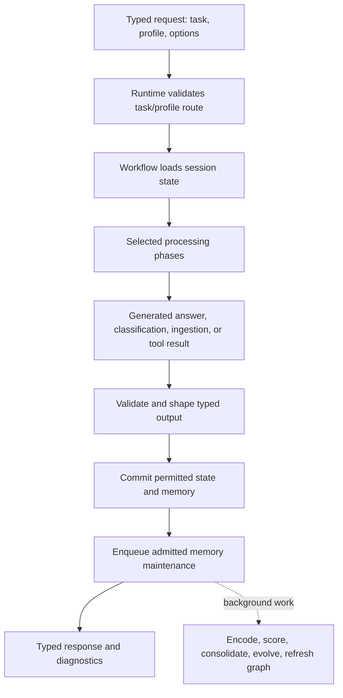

# PRIMA-NEXT explained: purpose, architecture, current state, and next steps

Prepared on 7 October 2026 from branch `3.10_to_3.14`, commit `4cd51950b22abbab22a0553348df51a36ac20c30`. Read this guide first, then use [the complete file reference](PROJECT_FILE_REFERENCE.md) to inspect individual files. [The source inventory](project-source-inventory.json) records the Python definitions, source line numbers, and imports used to check coverage.

## 1. What you are building

PRIMA-NEXT is an experimental **agent runtime**: software around a language model that gives it memory, a controlled sequence of operations, and a record of what happened. The model produces language; PRIMA decides what evidence to supply, what operations are allowed, when to try a correction, and what state to retain.

The repository's stated purpose is to build agents that remember, reason, plan, reflect, and act through controlled tools. It is currently a Python research system, rather than a finished user-facing assistant. `main.py` is only an interactive emotion-analysis demonstration. Running it does not exercise the complete PRIMA agent.

There are three related goals:

1. **Capability:** answer questions using relevant previous experiences/documents, retain useful information, and perform allowed tool operations.
2. **Reliability:** use one validated request boundary, bounded work, typed outcomes, controlled state changes, and honest diagnostics.
3. **Scientific evidence:** determine whether PRIMA's additional components improve results compared with the same model alone and a simpler retrieval system.

The recent operational objective, recorded in `docs/kaggle-12-hour-plan.md`, is to complete each of LoCoMo, HotpotQA, and GoEmotions in its own 12-hour Kaggle session, with the recorded required pinned 27B model, full source coverage, native scoring, resource guards, and validated output packages. This is a repository-recorded requirement; it is not a reason to invent a smaller benchmark or silently substitute a different model.

My recommendation is to make the next milestone **a reproducible memory-assisted agent whose measured quality and cost you can explain**. That is a proposed priority, not a claim that every long-term product decision has already been made. Your intended audience, deployment model, acceptable answer quality, and privacy policy are not fully specified in the code.

## 2. The vocabulary in plain language

| Term | Meaning in this project |
|---|---|
| Runtime | The public object that accepts a request and returns a response. |
| Workflow | The ordered operations used to handle that request. |
| Task | What the request asks for: conversation, factual QA, historical replay, ingestion, emotion classification, or a tool operation. |
| Profile | Which components are selected: model only, simple RAG, full PRIMA, ingestion only, or affect only. |
| RAG | Retrieve useful stored text, then give it to the language model as evidence. |
| Embedding | A numeric representation of text used for similarity search. The deterministic hash backend is a test baseline, not a learned semantic understanding model. |
| Dense retrieval | Compare text vectors. |
| Sparse retrieval | Match words and lexical features. |
| Temporal retrieval | Use time-related conditions. |
| Graph retrieval | Follow stored relationships between memory records. |
| Fusion / reranking | Combine candidate lists, then reorder the candidates. |
| Affect / PAD | Emotion classification and a pleasure/arousal/dominance representation. These are engineered signals, not psychological diagnoses. |
| Confidence | An internal score. Its value is not automatically an empirically calibrated probability of being right. |
| Reflection | Produce advice about a detected problem; the workflow decides whether to apply it. |
| Cold path | Background memory work after admission, separate from immediate answering. |
| Gold data | Correct answers/labels used by the evaluator. They must stay out of inference. |
| Canary / pilot | A small real run used to establish that execution works and measure resource/time behavior. |
| Ablation | Turn one feature off while keeping the rest fixed to determine its contribution. |

## 3. How one request travels through PRIMA

The authoritative public entry is `PrimaRuntime.execute(PrimaRequest(...))` in `runtime/prima_runtime.py`. `process`, `process_async`, `answer_question`, and `ingest_document` are compatibility adapters to this boundary.



The runtime constructs subsystem instances and an `ExecutionContext`. It resolves configuration and overwrites execution-control metadata with trusted task/profile/options values. This prevents caller metadata from replacing the selected route or budgets. `TaskRouter` requires that trusted route; it has no generic fallback route.

`OrchestrationEngine` runs the selected controllers, records lifecycle events, handles bounded retries/corrections, and carries a failed context back to the runtime. Controllers put their results into the execution context. `OutputController` shapes an existing result; it does not create a plausible-looking answer when generation failed.

Session state is loaded and committed with version checks. Conversation memory admission is a distinct decision from state persistence. Maintenance is also distinct: a successful answer does not by itself prove that all background work completed. Benchmarks use maintenance barriers to make the observation boundary explicit.

### The actual task/profile routes

There are currently **six task kinds, five profiles, and ten valid pairs out of thirty** in `runtime/route_profiles.py`. Older documentation describing 25 combinations and nine routes predates historical replay.

| Task | Valid profiles | Main behavior |
|---|---|---|
| Conversation | `model_only`, `simple_rag`, `prima_full` | Produce a response; apply configured conversation admission; persist state; enqueue admitted work. |
| Factual QA | `model_only`, `simple_rag`, `prima_full` | Generate factual output with a precomputed JSON schema; retrieved-evidence routes may abstain when sufficiency checks reject evidence. No conversational memory-commit phase. |
| Historical replay | `prima_full` | Replay historical turns through affect/state/memory admission without generating assistant answers. |
| Document ingestion | `ingestion_only` | Validate, embed, and store a document; no answer generation. |
| Emotion classification | `affect_only` | Run the affect/classification path; exclude QA retrieval/planning/world/tools. |
| Tool request | `prima_full` | Plan and gate an allowed tool action; exclude answer generation. |

Invalid combinations return a rejected typed response. A document-ingestion request does not become QA because it happens to contain a question mark.

The full conversation/QA route selects state load, affect, evidence acquisition, planning, symbolic world simulation, uncertainty, execution decision, reflection, action preparation, generation, validation, output, and appropriate commits/maintenance. Branches can skip action/generation or schedule corrections. Being selected is different from being executed; diagnostics must say which occurred.

### A concrete memory example

Suppose historical text says “Alex moved to Pune in June” and a later request asks “Where did Alex move?”

1. Ingestion or admitted historical replay creates a `MemoryNote` with text, provenance, time, embedding, and metadata.
2. `MemoryIndex` writes content to the selected repository and updates derived graph records.
3. Query analysis derives lexical/entity/time signals. The selected retrieval profile runs its strategies.
4. Fusion and reranking select candidates; evidence integration retains source identities.
5. The sufficiency checker decides whether the evidence supports answering. Compression fits selected evidence into the configured budget.
6. Generation presents untrusted evidence separately from trusted system policy, using stable citation labels rather than arbitrary storage IDs.
7. The model returns structured output; parsing maps citations back to stored evidence. Validation and workflow corrections run within limits.
8. A typed answer or explicit abstention/failure is returned with diagnostics.

The existence of “Alex” and “move” in a retrieved paragraph is not proof that it answers the question. This distinction is central to the quality work ahead.

## 4. Why each subsystem exists, and what it actually does

| Piece | Why it exists | Current implementation and improvement direction |
|---|---|---|
| `runtime/` | A stable API so applications and benchmarks use the same execution path. | Typed requests, route selection, subsystem construction, compatibility adapters, response/diagnostic assembly. Keep one boundary; remove obsolete duplicate helpers after checking callers. |
| `workflow/` | One owner of operation order, retries, cancellation, and correction decisions. | Controller adapters and a bounded engine. Preserve ownership; test observable transitions rather than assuming components ran. |
| `memory/` | Store usable evidence and retrieve it later. | Chroma or explicit in-memory repositories; five logical types; embeddings, metadata, lineage, retrieval, graph, maintenance. Prioritize relevant evidence, bounded growth, and isolation. |
| `affect/` | Derive emotion-related metadata that can influence state, salience, retrieval, and reflection. | Legacy lexical/similarity classifier plus optional learned GoEmotions encoder; PAD and rolling history. Measure the value of the influence separately from classification accuracy. |
| `reasoning/` | Acquire evidence in a bounded loop rather than retrieve indefinitely. | Conservative task routing, integration, lexical sufficiency, limited follow-up needs, stop policies and advice. Improve decisions using held-out evidence cases, not benchmark gold in inference. |
| `planning/` | Represent intended operations before effects happen. | Deterministic goals/actions/constraints and plan evaluation. This is not a general learned problem solver; keep plans useful to real decisions. |
| `world/` | Estimate plan consequences before execution. | Deterministic symbolic transitions and risk rules. Validate predictions against actual outcomes before treating them as probabilities. |
| `uncertainty/` | Combine signals and choose execution, correction, clarification, or abstention. | Weighted scores, default calibration profiles, deterministic gates. Fit calibration on development observations and measure coverage versus error. |
| `reflection/` | Explain detected failure conditions and propose bounded corrections. | Production advice adapter/engine, plus separately labeled legacy evaluator-driven helpers. Measure actual answer/evidence changes and regressions. |
| `action/`, `tools/` | Turn plans into validated, policy-controlled tool calls. | Allowlisting, arguments, registered handlers, results and audit records. Treat this as an application policy boundary; Python handlers are not OS-isolated by these classes. |
| `state/` | Own persistent session state and reject stale updates. | In-memory or JSON state managers and typed cognitive/emotional models. JSON persistence is suitable for controlled single-process use; multi-process service use needs transactions. |
| `events/` | Communicate lifecycle and admitted-memory work without direct subsystem mutation. | In-process events/store/subscribers; bounded maintenance supervision. Durability of queued work remains a separate requirement. |
| `llm/` | Keep provider transport and generation configuration out of the cognitive components. | HTTP adapters, capability checks, rate limiting, parsing, reusable client, prompt trust boundaries. Verify each deployed provider rather than assume all compatible servers implement the same guarantees. |
| `security/` | Centralize redaction and small validation/policy utilities. | Recursive diagnostics redaction and an active output guard; some older helpers are only exported utilities. Do not equate a regex or module's presence with complete security coverage. |
| `monitoring/` | Supply optional telemetry and health helpers. | OpenTelemetry wrappers with no-op fallback. Runtime diagnostics and campaign telemetry are more directly evidenced than a deployed monitoring endpoint. |
| `config/` | Resolve effective settings consistently. | Typed runtime configuration, provider settings, deployment modes, resource YAML. Keep recorded effective identities aligned with the actual backend. |
| `benchmarks/` | Measure task results with controlled cases and resumable artifacts. | GoEmotions, HotpotQA, LoCoMo and shared campaign infrastructure. This is evidence machinery, not part of production answer inference. |
| `evaluation/` | Explore memory, retrieval, reflection, and long-horizon behavior. | Synthetic generators, diagnostic runners, metrics and plotting. Keep exploratory results separate from complete benchmark claims. |
| `tests/` | Detect regressions in contracts, metrics, boundaries, and fault handling. | Deterministic unit/integration/architecture/fixture tests plus an opt-in real embedding/provider smoke. Fake-provider success proves wiring, not model quality. |

### The five memory types

Working memory is near-term retained information. Episodic memory is particular experiences/turns. Semantic memory is generalized information and derived summaries. Emotional memory represents affect-related records. Procedural memory describes how to perform an operation; admission is limited to verified successful tools or explicit procedure imports.

These are logical types in repositories, not five independent databases that must all be deployed. Four small store wrappers select their type; procedural storage is handled through the common taxonomy/index. Content belongs to the repository; graph nodes and edges are derived metadata pointing at memory IDs.

### Retrieval and maintenance are different jobs

Retrieval answers “What stored information is relevant now?” Maintenance answers “How should stored information be consolidated, abstracted, decayed, and indexed over time?” Expensive maintenance should not run repeatedly inside answering. The current supervisor uses a bounded queue and backpressure, retries, explicit barriers, and failure records. Some expensive work is batched until a flush.

Graph centrality and context overlap are deterministic signals. Semantic abstraction here is deterministic summarization; it is not automatically a verified fact extractor. Soft forgetting reduces retention; it does not implement a user's right to physically delete all stored personal data.

## 5. Current status: what is established and what is still open

The source supports a substantial research runtime with explicit contracts, profile-selected execution, workflow-owned synthesis and corrections, storage mode enforcement, state versions, controlled tools, maintenance barriers, and resumable benchmark accounting.

Important defaults: `PrimaRuntime` defaults to **test mode**, in-memory storage, deterministic `stable` embeddings, and a legacy affect backend. Settings default to an OpenAI provider/model identity. `model_only` bypasses retrieval; `simple_rag` uses dense/sparse retrieval; `prima_full` adds time/graph and the cognitive branches. A learned embedding or cross-encoder must be explicitly selected and its resources available. A no-key test suite does not mean a default real QA call can successfully contact a provider without configuration.

`docs/implementation/RELEASE_READINESS.md` records older Python 3.10 and Phase 15/16 validation. The README and CI now target 3.14. The July reasoning audit also describes an older call path. Read those documents as dated history, not as the current execution contract.

The October 6 readiness note records a real LoCoMo pilot on commit `8f54b16`: two variants completed the same 30 questions, equality checks passed, and the two-worker estimate was 9.2202 campaign hours / 10.1859 total session hours at its final check. It also records 14.10% F1 on a shared 15-case comparison versus 15.18% previously, with 23.17% evidence recall unchanged. **Those are reported repository measurements; this audit has not independently rerun the hardware experiment or verified its original archive.** They establish neither a PRIMA-versus-baseline quality gain nor full dataset completion. HotpotQA and GoEmotions still need their own real representative pilots according to the latest notes.

The notebook is already an operational pipeline: setup, model/dataset identity checks, real hardware preflight, canary/pilots, measured launch gate, native scoring, diagnostics, failure analysis, validation, packaging. Its smoke default deliberately prevents full-run claims.

Fresh local validation results and exact coverage are recorded at the end of this guide when the audit completes. No production campaign, model download, training, publishing, or deployment is part of this explanatory task.

## 6. The highest-value improvements

These are recommendations from the inspected implementation. A risk is labeled separately from a reproduced finding; none of these changes has been silently applied during this documentation task.

### A. First prove isolation and correctness of repeated operations

**Session boundaries need more than isolated cognitive state.** `DynamicAffectEngine.process` reads the request's emotional state but also updates a single `self.history`. One runtime reused across different sessions can mix temporal emotion history. Similarly, repository retrieval operates over its configured memory collection; `state_filter` boosts matches rather than enforcing user/session access. For a personal single-user research process this may be intentional; for multiple users it needs explicit enforced partitioning. Add a two-session regression showing B cannot affect A's emotional history or retrieve A's private records. Choose one runtime/repository per principal as the simplest initial deployment boundary, or make shared storage enforce the principal before ranking.

**Make evolution idempotent for unchanged parents.** `MemoryEvolutionEngine.evolve` creates a new `MemoryNote` for each qualifying community without checking an existing parent-set/policy identity. Repeated maintenance can therefore create repeated abstractions. Record a parent-set/summary-policy key and reuse an existing derived result; prove unchanged input does not keep increasing semantic memory. Preserve provenance when inputs change.

**Refresh graph relationships as well as nodes.** `GraphBuilder.index_note` adds edges for positive overlap but does not remove an old `shared_context` edge after overlap becomes zero. An updated note can retain stale relationships. Replace the affected derived relationships during refresh, while preserving unrelated lineage edges. Add one regression that changes a linked note into an unrelated note.

**Define the commit failure boundary.** State commit, memory commit, index updates, and queue admission are distinct operations. A later failure may occur after an earlier durable effect. Decide whether the contract promises atomicity or records a partially committed operation. Use request/event identity to make retry safe; fault-inject after each persisted step. Do not claim an all-or-nothing transaction unless it is implemented.

### B. Treat retrieval quality as the immediate model-quality bottleneck

The latest note's low evidence recall makes retrieval the first place to investigate. A larger model cannot recover evidence it never sees.

For a fixed development set, record whether the relevant source appeared in dense candidates, sparse candidates, fusion output, reranked candidates, compressed context, and model citations. This isolates candidate-generation failure from ranking, compression, sufficiency, and generation failure. The existing diagnostic machinery already exposes these stages.

Compare `stable` against an explicitly selected learned embedding on the same cases. Then compare lexical and cross-encoder reranking. Tune candidate count, fusion weights, and compression on development data only. Keep model, IDs/order, source history, context budget, seed, provider, retries, and evaluator fixed in paired comparisons. Avoid changing five features and attributing the delta to memory.

`SufficiencyVerifier` currently uses word coverage at a 0.60 threshold and a narrow contradiction pattern. It can reject useful paraphrases or accept text that repeats question words without answering the requested relation. Build a small held-out set containing paraphrases, ambiguous entities, dates, contradictions, and irrelevant word overlap. Measure false abstentions and unsupported answers before replacing the heuristic with a more expensive verifier.

`OutputValidationController` checks schema/error signals and whether citations were selected. A valid citation ID is not proof the cited sentence supports every claim. Add claim/evidence validation only where the target task requires it, with a measured accuracy/cost tradeoff.

### C. Measure the extra cognitive layers rather than assume they help

Planning and world simulation are deterministic heuristics. Confidence combines several correlated heuristic signals and default reliability weights. Affect classification confidence is different from factual answer confidence. Reflection advice confidence or confidence lift is different from measured correctness improvement.

Use matched ablations: simple RAG versus full PRIMA; full PRIMA without affect; without graph; without reflection; and the same retrieval with one versus bounded multiple hops. Report answer quality, retrieval recall, abstention coverage, corrections that help/harm, latency, tokens, and memory growth. Retain features whose gains meet your chosen tradeoff. Leave a component optional when its value is unproven.

Fit thresholds/calibration on development outcomes and freeze them for evaluation. Report calibration error and error at each answer coverage level. Never tune on the final test labels and then describe the resulting numbers as held-out performance.

### D. Close the real tool-execution gaps before giving it important side effects

`ToolExecutor` invokes `tool.handler.execute` directly and only wraps the returned awaitable in `asyncio.wait_for`. A synchronous handler can block before the timeout is applied. Restrict the handler contract to genuinely async bounded operations or isolate blocking handlers appropriately; use a process boundary for a hard kill requirement. A thread timeout alone cannot stop an already running side effect.

Timeouts/retries do not imply that an external operation did not happen. Retry only operations with a defined idempotency key or a reconciliation path. Sandbox tags and allowlisting express application policy; they do not prevent arbitrary filesystem/network access by the handler itself. Choose actual process/container/OS restrictions if untrusted tools are introduced.

### E. Make storage recoverable at the required deployment scale

The supervisor's queue/deduplication sets are process-local; terminal failures can be persisted, but a crash can lose pending work. For deployment where admission must imply eventual maintenance, persist admitted work and replay it idempotently. A local journal is a possible first step; an external broker is unnecessary until operational requirements justify one.

`JsonStateManager` uses a process-local lock and a JSON replacement file. Multiple independent writers are outside its safe design boundary. If you need multiple service processes, use a transactional state backend with compare-and-swap semantics. Back up content/state, test restoration, and ensure embedding model/representation identities are compatible before retrieval resumes.

Graph rebuilding compares note pairs; sparse and temporal strategies scan records. Large memory stores can be expensive even after caching keyword overlap. Profile actual scaling and apply incremental indexing/filtered queries to the measured hot stage. Preserve edge/score/evidence equivalence instead of dropping work to make the benchmark fit.

### F. Reduce maintenance burden once the behavior is stable

`runtime/prima_runtime.py` is 1,300 lines and contains compatibility assembly/persistence/logging helpers. Some appear to have no remaining callers beyond their definitions. Confirm symbol callers and delete dead paths before splitting classes merely to make files smaller. Keep the typed public adapters users still call.

Legacy `AdaptiveReflectionPipeline` and `VerifierAdapter` are evaluator-only and can use benchmark truth. They must not become the production reflection path. The older reasoning audit and truth-matrix route counts need an explicit current-versus-historical label. Keep one current architecture document supported by route tests.

The output secret guard rejects words such as “password” even in benign explanations. The input sanitizer removes suspicious phrases and truncates text, and is not itself evidence of runtime-wide injection protection. Redaction, provider prompts, access controls, tool authorization, and logging need explicit contracts. Add representative legitimate security-topic output and leakage cases before changing the rule.

Setup installs research/training/metric dependencies alongside runtime dependencies; this is a deliberate current choice but makes installation heavy. If installation cost becomes a barrier, separate optional research extras without changing default research coverage. Resolve/pin an experiment's dependency set for reproducibility; lower bounds alone can select different future environments.

## 7. A practical sequence to finish the current goal

| Stage | Concrete work | Evidence required to call it done |
|---|---|---|
| 1. Establish a trustworthy baseline | Freeze checkout, environment, dataset/model identities, effective config; run local checks. | Fresh tests/checks, source coverage, no unexplained runtime errors. |
| 2. Repair correctness boundaries | Session isolation, repeated evolution, stale graph edges, bounded tools, commit/retry behavior. | Small regressions fail before the fix and pass afterward; unchanged valid routes still work. |
| 3. Diagnose retrieval | Use existing stage diagnostics on development failures; compare embeddings and reranking. | Source-level error breakdown and held-out retrieval gains, with cost measurements. |
| 4. Validate full operational runs | Real benchmark-specific canary/pilot, measured time gate, then full source run per session. | Exact expected IDs/counts/hashes; unique terminal checkpoints; completed maintenance; real metrics; validated archive. |
| 5. Establish PRIMA's contribution | Matched model-only/simple-RAG/full-PRIMA comparisons and focused ablations. | Native paired statistics and honest failure/abstention accounting; no gold leakage. |
| 6. Choose a small product boundary | Decide audience and deployment; expose the existing runtime through a minimal CLI/API/UI as needed. | One actual user scenario works end to end with persistent memory, isolation, recovery, and acceptable quality/latency. |
| 7. Harden to that boundary | Access controls, durable admitted work if required, idempotent side effects, deletion/export, restore tests, service monitoring. | Deployment-specific acceptance checks and operational recovery evidence. |

Do not start by adding another cognitive package. The immediate path is to use the components already present, fix demonstrated correctness defects, obtain complete real evidence, and choose the smallest feature set that meets the intended task.

### How to execute the Kaggle objective correctly

1. Use a new session for the selected benchmark and preserve the existing pinned identities/guards. Smoke checks wiring/resources on at most three unique examples and remains non-reportable.
2. For representative measurements use `SMOKE_MODE=False` with the full-run flag still off. Run sections 1–9; record full histories, native outcomes, completed maintenance, resources and sequential/concurrent equivalence.
3. Admit concurrency only if that benchmark's native equality, real overlap, and memory checks pass. LoCoMo's pilot does not authorize the other datasets.
4. Section 10 must pass the live measured gate: campaign estimate within 10.5 hours and total session within 12 hours, including elapsed setup/pilots and artifact headroom. A previous session's passing estimate is not current authorization.
5. Launch the full selected source; preserve checkpoint/resume identity. A completed sampled child mode is not complete source coverage.
6. Run native scoring, coverage checks, failure reconciliation, credential checks, archive validation, and checksum reporting. Preserve partial results as partial if anything is incomplete.
7. Run paired comparisons under matching conditions before saying PRIMA improved accuracy. Reportability and quality are separate: a complete run can still show poor performance.

### Define “everything right” as observable acceptance criteria

The repository already has structural criteria. Add explicit target numbers before final evaluation: which quality metric matters, minimum useful recall/accuracy, acceptable error at a chosen coverage, latency/token/storage budgets, and tolerated reflection harm. These numbers are product/research decisions; source code alone cannot establish them.

Completion means valid requests run the selected path; invalid ones are rejected; users' data remains isolated; evidence and citations are traceable; persistence/retries survive the promised failures; tools obey policy; metrics are independently scored; full benchmark coverage is reconciled; and the system meets the targets you froze in advance. Passing lint and observing a complex diagram are insufficient acceptance criteria.

## 8. How to read and change this repository

Read `runtime/contracts.py` and `runtime/route_profiles.py` first. Follow `PrimaRuntime.execute`, then `OrchestrationEngine.execute`, then the selected controller in `workflow/prima_workflow.py`. Inspect the subsystem it calls and the matching test file. Use the file reference's static relationships to find neighboring callers, while remembering that an import/export is not proof of execution.

For memory QA, follow ingestion → note/embedding pipeline → repository/index → retrieval → bounded reasoning → compression → answer generation → parsing/validation. For tools, follow planning → world/uncertainty gate → action executor → policy → registry/router/validator → handler result. For maintenance, follow memory admission → typed event → supervisor → pipeline → consolidation/evolution/graph.

Before changing a shared function, search every caller. Change one cause rather than patching each symptom. Leave the smallest meaningful regression check. Run focused checks first, then the appropriate full quality gates once the change is stable. Avoid rewriting scoring and runtime behavior together: that makes experimental deltas difficult to interpret.

The file reference includes every discoverable project-owned Python file, tests, upstream Python files, executable notebook sections, setup/CI code, and upstream shell/web source. Installed dependencies, generated caches/bytecode, dataset payloads and model weights are not authored source explanations; their roles and boundaries are recorded separately. This is exhaustive file coverage, not a claim that every possible dynamic branch or deployed environment was executed.

## 9. Fresh audit evidence and limits

Only the three documentation/inventory artifacts were added. Runtime behavior and benchmark scoring were not changed. The temporary reference builder was removed after its coverage assertions passed; pre-existing scratch files were preserved.

| Check | Fresh result on this checkout |
|---|---|
| File coverage | 385 owned Python files / 44,720 source lines plus 53 upstream Python files; each appears exactly once in the reference. |
| Other source | 19 notebook code cells parsed; all 23 discovered shell/PowerShell/web-source files accounted for, plus CI/configuration and retrieval resource files. |
| Links | Every local Markdown target in both reports exists. |
| Environment | Existing `.venv` runs Python 3.14.8; the launcher prints a base-interpreter-location warning. No environment reinstall was performed. |
| Ruff | `ruff check .`: all checks passed. |
| Mypy | `mypy .`: success, no issues in 230 source files under the configured scope. This is not strict typing of the entire repository. |
| Xenon | Existing production-source allowlist gate passed. Its thresholds are permissive; passing does not eliminate complexity debt. |
| Capability preflight | ROUGE-L, BERTScore and GoEmotions encoder dependencies reported available. Availability does not prove a model is downloaded, a real endpoint works, or GPU residency is safe. |
| Focused tests | Affect tests, GoEmotions dataset/metric tests and recall/MRR/nDCG tests: **25 passed in 1.65 seconds**. |
| Full pytest | **Not verified.** The default temporary directory could not be created. A workspace `--basetemp` avoids that error, but asynchronous cases then stall while constructing Windows' event-loop socket pair. A 45-second fault-handler trace locates the wait in `socket.accept → _fallback_socketpair → asyncio._make_self_pipe`; the smoke case's worker is blocked before its async runtime execution. Stalled runs were interrupted. The environment is the leading explanation; this does not establish a production runtime defect or a clean full-suite pass. |
| Bandit | **Not a clean whole-workspace pass.** After removing the temporary builder, scanning still reports one low-severity assertion finding in the pre-existing ignored `pytest-tmp/runtime-cost-review/profile_hotpot_ingestion.py`; two generated scratch checkout files are skipped as invalid Python. No medium/high findings were reported in that run. CLI `-x pytest-tmp` did not override the configured exclusions as intended. Clean CI scope and local scratch scope must be distinguished. |
| Whitespace | `git diff --check` passed for tracked changes; new report links/content were separately checked. |

Three isolated, in-memory source probes reproduced the concerns in section 6 without altering the persistent project stores:

| Probe | Observed result | Implication |
|---|---|---|
| Two `evolve()` calls over the same two linked episodic parents | One abstraction created on each call; semantic count grew from one to two. | Add unchanged-derivation reuse before treating evolution as idempotent maintenance. |
| Refresh one linked note with unrelated content/context | The old shared-context edge remained. | Derived graph refresh needs removal/replacement semantics, not only addition. |
| Process two utterances with separate fresh `CognitiveState` instances on one affect engine | Engine history length became two. | Cognitive-state separation does not separate the engine's temporal history. |

These probes confirm the narrow behaviors stated here. They are not a claim of measured cross-user exploitation, production data loss, or a full model-quality audit. The broader isolation, durability, timeout, calibration and commit recommendations are source-backed risks to validate against the deployment you choose.

To reproduce the passing focused test boundary:

```powershell
.\.venv\Scripts\python.exe -m pytest tests/affect tests/test_goemotions_benchmark.py tests/retrieval/test_recall_metrics.py tests/retrieval/test_mrr_metrics.py tests/retrieval/test_ndcg_metrics.py -q --basetemp=C:/PRIMA_next/pytest-tmp/project-audit-sync-20261007
```

Run the complete suite again in a supported local/CI environment where Windows event-loop sockets and temporary directories work before recording a new release-readiness decision. No fresh complete Kaggle results were produced by this audit.
